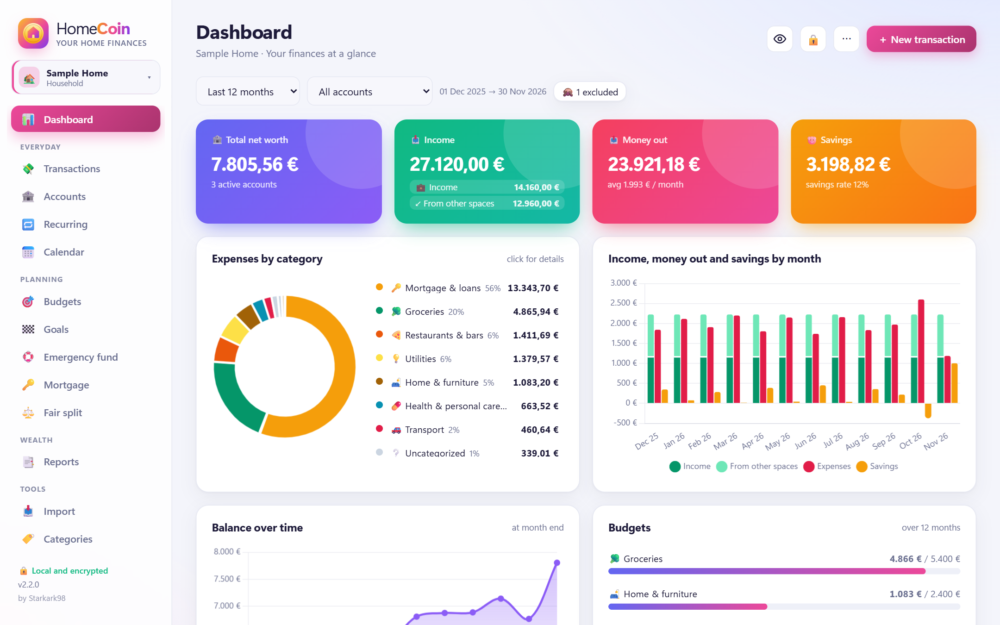
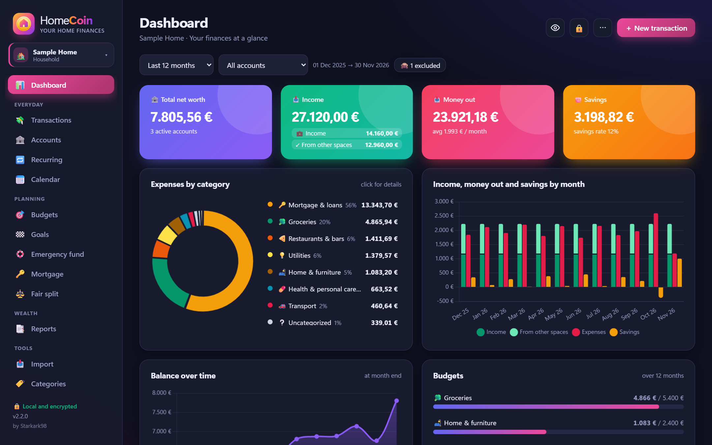
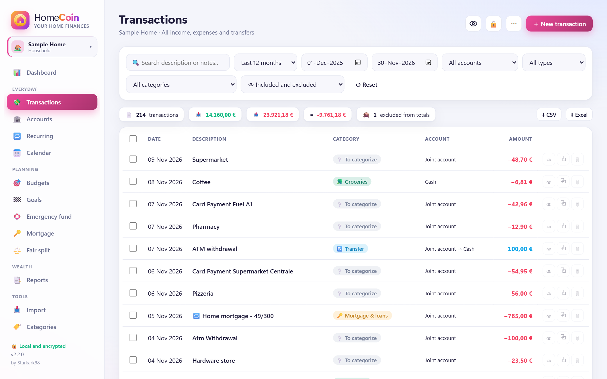
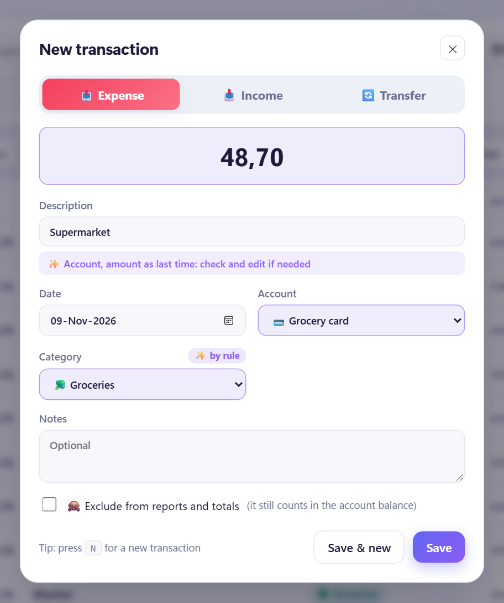
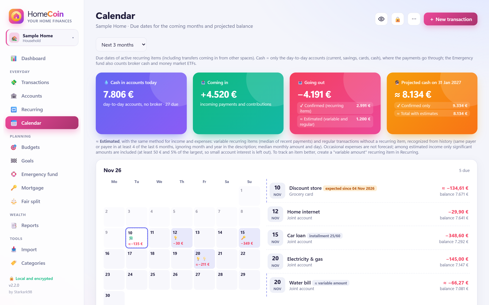
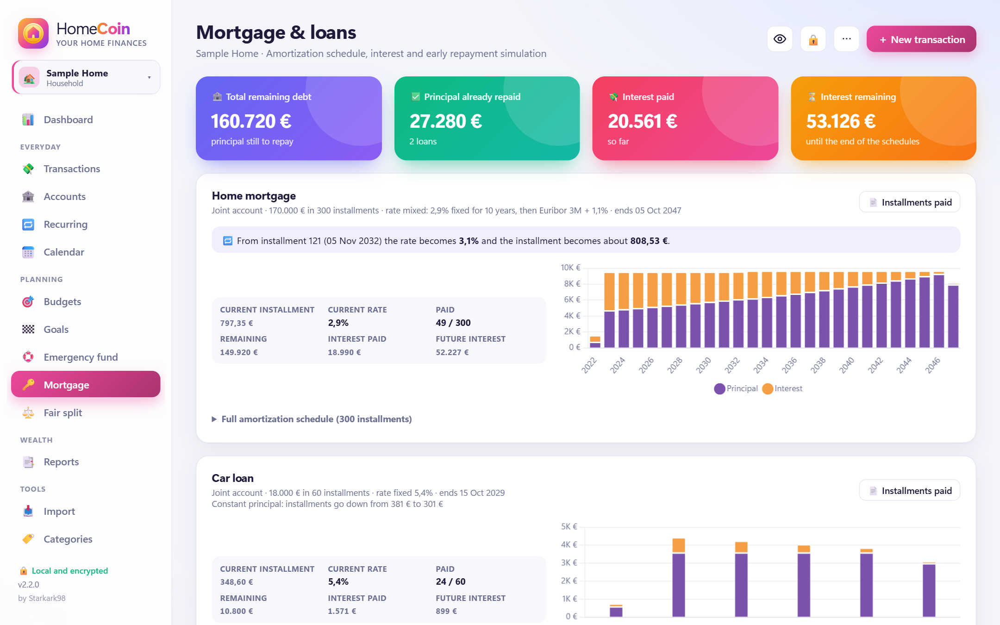
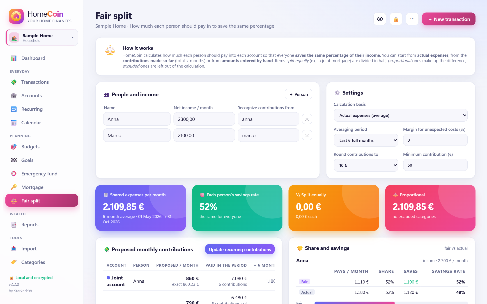
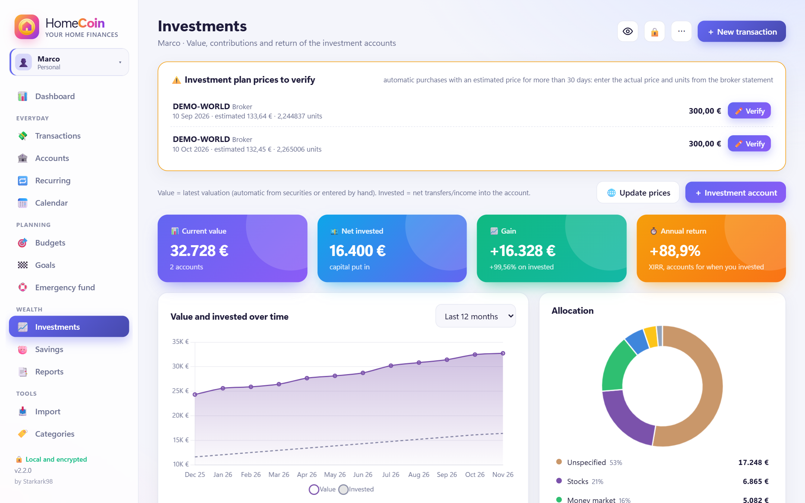
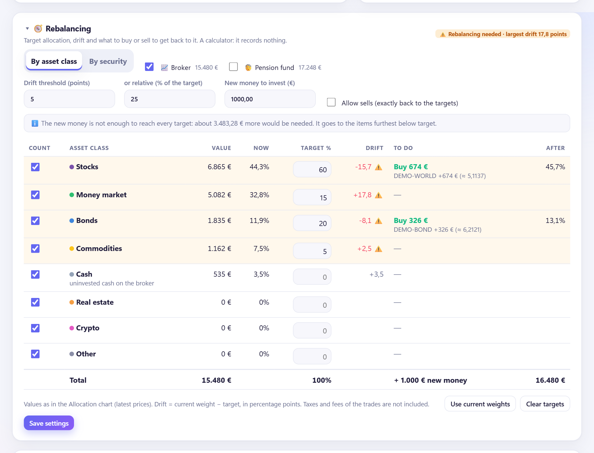
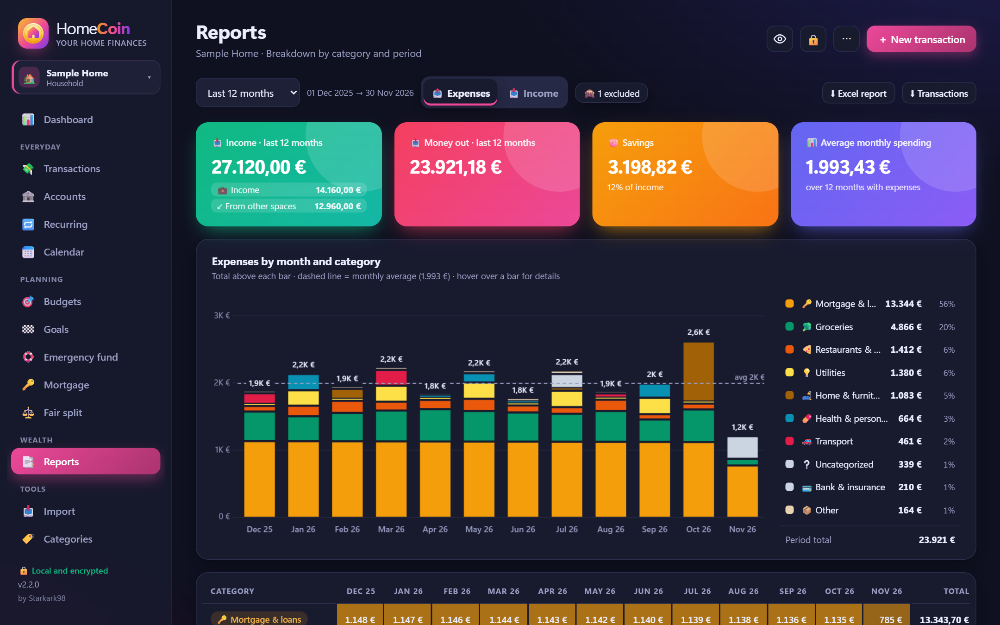

<p align="center"></p>

# HomeCoin *by Starkark98*


[](https://ko-fi.com/starkark98)

**Your household finances on your own PC. Free, private, encrypted. No cloud, no account, no subscription.**

HomeCoin keeps track of your money in one place: accounts, expenses and income, recurring payments, budgets, savings goals, a mortgage, investments. It works for a whole household and for each person in it. Everything stays on your computer, locked with your password.



> **Get started in two minutes:** download **`HomeCoin-Setup-<version>.exe`** from [Releases](https://github.com/Starkark98/HomeCoin/releases) and run it. No administrator rights, nothing else to install.
> **Just curious?** Try the [demo](#try-the-demo-first) first: it opens HomeCoin with made-up data.

---

## Why it exists

Although understanding basic economic principles, and especially personal finance, is essential for leading a fulfilling, happy life and achieving our goals, no one teaches us how to manage our money effectively, much less provides us with the tools we need to do so.

HomeCoin was created precisely to offer a comprehensive “all-in-one” tool for managing our finances, one that adapts to each person’s unique situation and makes managing our money easy and enjoyable.

The project is independent and completely free, available on this official GitHub repository. It is continuously updated and maintained solely by me, and I’m especially open to advice and suggestions for ongoing improvement.

Taking care of our finances isn’t as difficult as we’re led to believe...it can even be enjoyable and fun!

Every additional coin saved and invested thanks to HomeCoin will be a source of satisfaction and deep pride for me.

Thank you!

Starkark98

---

## Contents

**Start here**
- [What HomeCoin does](#what-homecoin-does)
- [What you need](#what-you-need)
- [Install](#install)
- [Your first start](#your-first-start)
- [Try the demo first](#try-the-demo-first)

**Guide** (same order as the app menu)
- *The basics:* [How HomeCoin is organized](#how-homecoin-is-organized) · [Language and currency](#language-and-currency) · [Typing amounts and dates](#typing-amounts-and-dates) · [Spaces](#spaces) · [Dashboard](#dashboard)
- *Everyday:* [Transactions](#transactions) · [Accounts](#accounts) · [Recurring payments](#recurring-payments) · [Calendar](#calendar)
- *Planning:* [Budgets](#budgets) · [Goals](#goals) · [Emergency fund](#emergency-fund) · [Mortgage and loans](#mortgage-and-loans) · [Fair split](#fair-split)
- *Wealth:* [Investments](#investments) (with [Rebalancing](#rebalancing)) · [Savings](#savings) · [Reports](#reports)
- *Tools:* [Importing bank statements](#importing-bank-statements) · [Categories and rules](#categories-and-rules) · [Activity log](#activity-log) · [Settings](#settings)

**Your data**
- [Password and recovery key](#password-and-recovery-key)
- [Backups](#backups) · [Moving to a new PC](#moving-to-a-new-pc)
- [Updates](#updates)
- [Privacy and security](#privacy-and-security)

**More**
- [Questions and problems](#questions-and-problems) · [Limitations](#limitations)
- [Getting help](#getting-help) · [Support the project](#support-the-project) · [Contributing](#contributing)
- [Built with AI assistance](#built-with-ai-assistance) · [Disclaimer](#disclaimer) · [License](#license)

---

# Start here

## What HomeCoin does

- **Shows where your money goes.** Every expense and income in a category, with charts by month and by category (expense tracking).
- **Does the boring work for you.** It imports bank statements, records recurring payments when they are due and suggests categories from what you did before.
- **Looks ahead.** A calendar of the payments coming up and how much cash you will have left (cash-flow forecast); budgets that warn you before you overspend.
- **Helps you plan.** Savings goals with the amount to put aside each month, an emergency fund check, a mortgage amortization schedule with early-repayment simulation, a fair way to share household costs.
- **Follows your investments.** Value, gains, return, asset allocation and a rebalancing calculator that tells you what to buy or sell to get back to your target.
- **Keeps your data yours.** It runs on your PC only, the data is encrypted, and nobody (not even the author) can open it without your password.
- **Speaks your language.** Deutsch, English, Español, Français, Italiano, Nederlands, Polski, Português (Brasil), 日本語 (Japanese), 繁體中文 (Traditional Chinese) or 한국어 (Korean), with the number format of your currency.

Each page is shown with a screenshot in the [Guide](#guide) below. All screenshots come from the demo, with made-up data.

## What you need

- A PC with **Windows 10 or 11** (64-bit).
- A browser: Edge, Chrome or Firefox. HomeCoin opens inside it, but it does **not** go on the internet: it is a small program running on your own PC (a local web server on `127.0.0.1`, also called *localhost*).
- For the ZIP version only: Python 3.12, 3.13 or 3.14 from python.org. The installer brings its own Python, so most people don't need this.

## Install

### With the installer (recommended)

1. Open the latest [release](https://github.com/Starkark98/HomeCoin/releases) and download **`HomeCoin-Setup-<version>.exe`**.
2. *Optional but wise:* check that the file is genuine. Every file has a unique fingerprint (its SHA-256 hash): in PowerShell, type `Get-FileHash .\HomeCoin-Setup-<version>.exe` and compare the result with the one written in the release. If they match, the file is exactly the one published.
3. Run the file. Windows may say *"Windows protected your PC"* (Microsoft Defender SmartScreen), because the installer does not carry a digital publisher signature yet (it is not code-signed): click **More info → Run anyway**.
4. Choose whether you want a desktop shortcut and whether HomeCoin should start with Windows (it then starts locked, without opening the browser). That's all.

HomeCoin is installed for your Windows user only, in `%LOCALAPPDATA%\Programs\HomeCoin`. It needs no administrator rights and does not touch the rest of the system.

**Opening and closing.** Open HomeCoin from the Start menu or the desktop shortcut: it opens in your browser. It runs in the background without a window. To stop it, use **⋯ → Close HomeCoin** (top right). If you click the shortcut while it is already running, it simply opens the page again.

**Uninstalling** removes the program and **keeps your data**, telling you where it is.

### With the ZIP (if you prefer to use your own Python)

1. Install Python 3.12, 3.13 or 3.14 from python.org (for example `winget install Python.Python.3.12 --scope user`). The Microsoft Store version does not work.
2. Download **`HomeCoin-v<version>.zip`** from the release and extract it into a folder of yours, for example `C:\Tools\HomeCoin`.
3. Right-click **`setup.ps1`** → *Run with PowerShell*. It runs once and prepares everything: a private Python environment (`.venv`) with the exact library versions listed in `requirements.lock`, each checked against its SHA-256 hash.
4. Double-click **`HomeCoin.cmd`**. The browser opens `http://127.0.0.1:8765`.
5. To stop HomeCoin, close its black window or use **⋯ → Close HomeCoin**.

Options: `HomeCoin.cmd --port 9000` (another port), `HomeCoin.cmd --no-browser`.

## Your first start

The first time, HomeCoin guides you through a few short steps:

1. **Choose your language and a password.** The language is proposed from your browser; change it in the box at the top if needed. The password needs at least 8 characters, and very common ones are refused. A short sentence is easy to remember and hard to guess.
2. **Save your recovery key.** It is shown only once. Write it down or keep it in a password manager: it is the only way back in if you forget the password. Without the password and the recovery key, **nobody can open your data, not even the author**.
3. **Pick your currency**: euro (€), US dollar ($), British pound (£), Swiss franc (CHF), Canadian dollar (C$), Australian dollar (A$), Mexican peso (MX$), Colombian peso (COL$), Chilean peso (CLP$), Brazilian real (R$), South African rand (R), New Zealand dollar (NZ$), Singapore dollar (S$), Hong Kong dollar (HK$), Philippine peso (₱), Indian rupee (₹), UAE dirham (AED), Malaysian ringgit (RM), Swedish krona, Norwegian krone or Danish krone (kr), Israeli shekel (₪), Czech koruna (Kč), Polish złoty (zł), Japanese yen (¥), New Taiwan dollar (NT$) or South Korean won (₩). HomeCoin proposes the one of your country, from the browser and the language you chose.
4. **Create your first space**: *Household* (shared costs, several people paying in) or *Personal* (your own money). See [Spaces](#spaces).
5. **Add your main account** and, if you want, its current balance.

Then you land on the Dashboard. A good next step is to [import a bank statement](#importing-bank-statements) or to add your [recurring payments](#recurring-payments).

## Try the demo first

The demo opens HomeCoin with two sample spaces and 18 months of made-up data, so you can click around without entering anything. It uses its own separate folder, is recreated at every start and never touches your real data. Online features are off.

- **ZIP version:** double-click **`HomeCoin-Demo.cmd`**.
- **Installed version:** press *Win + R* and run `"%LOCALAPPDATA%\Programs\HomeCoin\python\pythonw.exe" "%LOCALAPPDATA%\Programs\HomeCoin\demo.py"`. Close it with **⋯ → Close HomeCoin**.

The sign-in screen shows the demo password. The sample data is in the language of your Windows; if you change the language in Settings, the demo uses it the next time you start it. Its amounts are in euros (you can switch the currency label in Settings). The demo includes every feature: a household with a mortgage, a car loan, bills, a fair split, budgets and goals; a personal space with salary, a credit card, a broker with ETFs, a pension fund and a rebalancing target. On the Import page, **Try it with a sample bank statement** loads a made-up statement to see how importing works.

---

# Guide

The guide follows the menu of the app: first the basics, then the pages of each group in the same order as on the left of the screen.

## The basics

### How HomeCoin is organized

- **Left menu**, grouped by what you do:
  - **Everyday:** Transactions, Accounts, Recurring, Calendar
  - **Planning:** Budgets, Goals, Emergency fund, Mortgage, Fair split
  - **Wealth:** Investments, Savings, Reports
  - **Tools:** Import, Categories, Activity log, Settings
- **Top left:** the space you are in, and the switch to the others.
- **Bottom left:** the version of HomeCoin you are using.
- **Top right:** 👁 hides all amounts (useful when someone is looking at your screen), 🔒 locks HomeCoin, **⋯** has the light/dark theme switch, Settings, *Help* (this guide), *Support HomeCoin* (Ko-fi) and *Close HomeCoin*. **＋ New transaction** is always there.
- **Shortcuts:** <kbd>N</kbd> adds a transaction, <kbd>Esc</kbd> closes windows and menus.
- **Click to dig in** (drill-down). Click a category, a bar of a chart or a cell of a report and you get the list of the transactions behind it.
- **Warnings.** When something does not add up (a missing price, a date already passed, too little history for an average), HomeCoin tells you with a yellow ⚠️ or a grey ℹ️ note right where it matters.

Not every space needs every page: in Settings → Spaces you choose which optional pages each space shows. Hiding a page never deletes its data.

### Language and currency

- **Language** (Settings → General): Deutsch, English, Español, Français, Italiano, Nederlands, Polski, Português (Brasil), 日本語 (Japanese), 繁體中文 (Traditional Chinese) or 한국어 (Korean). It changes menus, messages, dates (in the order of the language: `10 Nov 2026`, `2026年11月10日`), exports and the names of the categories of **new** spaces. The categories you already have keep their names, so changing language never touches your data. The sign-in screen uses the chosen language too.
- **Currency** (Settings → General): the currency your accounts are kept in, with the number format of its country (see the table below). Language and currency are independent: a Swiss user can have the interface in French and amounts in Swiss francs.
- The translations other than English and Italian are new: if you find a wrong or clumsy word, please report it (see [Getting help](#getting-help)).

### Typing amounts and dates

- **Amounts follow your currency.** Each currency is written the way its country writes it:

  | Currency | Shown as | Notes |
  |---|---|---|
  | Euro (EUR) | `1.234,56 €` | comma for decimals: typing `1.500` means one thousand five hundred |
  | US dollar (USD) | `$1,234.56` | |
  | British pound (GBP) | `£1,234.56` | |
  | Swiss franc (CHF) | `CHF 1'234.56` | apostrophe for thousands |
  | Canadian dollar (CAD) | `$1,234.56` | |
  | Australian dollar (AUD) | `$1,234.56` | |
  | Mexican peso (MXN) | `$1,234.56` | |
  | Colombian peso (COP) | `$ 1.235` | no decimals |
  | Chilean peso (CLP) | `$1.235` | no decimals |
  | Brazilian real (BRL) | `R$ 1.234,56` | comma for decimals, as for the euro |
  | South African rand (ZAR) | `R 1 234,56` | space for thousands, comma for decimals |
  | New Zealand dollar (NZD) | `$1,234.56` | |
  | Singapore dollar (SGD) | `$1,234.56` | |
  | Hong Kong dollar (HKD) | `HK$1,234.56` | |
  | Philippine peso (PHP) | `₱1,234.56` | |
  | Indian rupee (INR) | `₹12,34,567.89` | Indian grouping in lakh and crore |
  | UAE dirham (AED) | `AED 1,234.56` | |
  | Malaysian ringgit (MYR) | `RM 1,234.56` | |
  | Swedish krona (SEK) | `1 234,56 kr` | space for thousands, comma for decimals |
  | Norwegian krone (NOK) | `1 234,56 kr` | space for thousands, comma for decimals |
  | Danish krone (DKK) | `1.234,56 kr.` | comma for decimals |
  | Israeli new shekel (ILS) | `₪1,234.56` | |
  | Czech koruna (CZK) | `1 234,56 Kč` | space for thousands, comma for decimals |
  | Polish złoty (PLN) | `1 234,56 zł` | space for thousands, comma for decimals |
  | Japanese yen (JPY) | `¥1,235` | no decimals: amounts are shown rounded to the yen |
  | New Taiwan dollar (TWD) | `$1,234.56` | |
  | South Korean won (KRW) | `₩1,235` | no decimals |

  Where the dot is the decimal separator, `1.5` is one and a half and `1,500` is one thousand five hundred. You can always type plain numbers like `1234.56`, and HomeCoin also understands amounts pasted with a symbol or a currency code.
- The currency is only a **label**: HomeCoin never converts amounts. Choose the currency your accounts are kept in. You can change it in Settings → General; security prices are then downloaded again in the new currency.
- **Dates** can be typed as `31/12/2026`, `2026-12-31` or picked from the calendar. HomeCoin refuses impossible years (a typo like 2062) to protect your data.

### Spaces

A space is a separate set of books (a separate ledger) inside the same HomeCoin, with its own accounts, categories, rules and reports. Typical setups:

- **One household space** for the shared account, plus **one personal space per person**.
- Or just one personal space, if you manage only your own money.

**Each space has its own color and icon.** The color tints a few small things, so you always see where you are: the highlighted page in the menu, the **＋ New transaction** button, the line under the selected tab and the message when you switch space. Everything that carries meaning (warnings, income and expenses, charts, buttons that confirm an action) looks the same in every space. You choose color and icon when you create or edit a space.

The type matters: a *Household* space gets shared categories (mortgage, utilities, groceries, contributions) and the Fair split page; a *Personal* space gets personal categories and the Investments and Savings pages. You can change the pages later.

**Money between spaces.** A transfer from your personal account to the household account is not an expense or an income: it is shown in both spaces and counts correctly in **net worth** (everything you own minus what you owe). You create, edit, archive or delete spaces in Settings → Spaces.

### Dashboard

The first page you see: net worth, income, money out, savings, expenses by category, the last months, budgets, upcoming payments and the largest expenses, for the period you choose.


*The Dashboard in the dark theme (it follows Windows, or choose it in Settings).*

## Everyday

### Transactions

Each transaction is an **expense**, an **income** or a **transfer** between two of your accounts.


*Transactions: filters, search, bulk edit and export.*

- **Adding one:** ＋ New transaction (or <kbd>N</kbd>). As you type the description, HomeCoin suggests previous ones and fills in the usual account, category and amount.

  
  *A new transaction: account, amount and category filled in from history and rules.*

- **Finding one:** filter by period, account, category or type, or search the text.
- **Several at once** (bulk edit): select them to change their category, exclude or include them, or delete them, in one go.
- **⧉ Duplicate** copies a transaction, handy for one that repeats now and then.
- **👁 Exclude:** a transaction you don't want in reports and budgets (for example something you bought for a friend who paid you back) still counts in the account balance but not in your spending.
- **Duplicates:** HomeCoin warns you when the same amount on the same account was already recorded a few days before, and asks before saving.
- **Export:** CSV or Excel, from Transactions or from Settings → Backup & data. Numbers and dates are written the way a spreadsheet of your currency's country expects them.

### Accounts

Add every place where you keep money: current accounts, savings accounts, credit and prepaid cards, cash, investment accounts. For each one you set a name, an icon, a color and the **opening balance** (what it held on the day you start using HomeCoin).

- A **credit card** can have a negative opening balance (what you owe).
- An account you closed can be **archived**: it disappears from the lists but its history stays in the totals of the past.
- HomeCoin warns you before a change that would alter your figures (for example changing the type of an account with transactions) and refuses to delete accounts that still have data.

### Recurring payments

Payments that repeat — rent, mortgage, loans, bills, subscriptions, salary, transfers to savings — are set up once in **Recurring**. On each due date HomeCoin records the transaction for you.

- **Frequency:** weekly, monthly, every 2, 3 or 6 months, yearly.
- **Loans in installments:** add the number of installments, the amount borrowed and the rate, and the loan appears in [Mortgage and loans](#mortgage-and-loans). With *constant principal* repayment you don't type the amount: HomeCoin records each installment with its own amount, taken from the schedule.
- **Investment plans** (regular savings plans, also known as dollar-cost averaging; *PAC* in Italy): a monthly transfer to an investment account can buy units of a security automatically, at an estimated price; HomeCoin reminds you to confirm the real price later.
- **Variable items** (a bill or salary that changes a little every time): mark them as *expected*. HomeCoin does not record them by itself: it links the real transaction when it arrives (by a keyword in the description) and forecasts the next amount as the median (the middle value) of the last six payments. After a raise or a new tariff you can tell it to use the amount you set instead, until the median catches up. If a payment is more than a week late, you get a warning.
- Pausing an item or changing its dates never creates payments in the past by surprise.

### Calendar

A **cash-flow forecast**: the payments of the coming months — confirmed recurring items plus estimated ones (variable items and regular income guessed from your history) — on a monthly grid, with the **cash you will have** after each payment and the lowest point of the period. Useful to see a tight month coming. *Cash* here means your day-to-day accounts (current and savings accounts, cards, cash), where payments actually go through; money on a broker is not counted.


*Calendar: confirmed and estimated payments, with the cash left after each one.*

## Planning

### Budgets

Set a **monthly limit** for the categories you want to watch, directly on the Budgets page. For each one you see what you have spent this month, the average of past months, and a warning when you are spending faster than the month is passing (*ahead* of pace: 60% of the budget spent after a third of the month, for example) or have gone over.


*Budgets of a closed month: one category went over its limit.*

### Goals

A goal is something you are saving for: a trip, a car, a down payment. Give it an amount and, if you want, a date. Its progress comes either from **the balance of an account** (for example a savings account dedicated to it) or from **an amount you update by hand**.

HomeCoin calculates **how much to put aside each month** to get there on time; in a household space, also each person's share in proportion to income. It warns you if the date has passed or if two goals use the same account (the same money would be counted twice).

### Emergency fund

How many months of expenses your **available reserve** (your liquid assets) would cover if your income stopped: your accounts plus uninvested cash and money market funds on your broker (money you can get within days). Stocks, bonds and other funds are not counted. Set your target in months (often 3 to 6); HomeCoin shows how far you are. The average spending uses your last 6 complete months, and HomeCoin tells you if you have less history than that.

### Mortgage and loans

Every recurring item with installments appears here with its **amortization schedule**: each installment split into **principal** (the part that repays the debt) and **interest**, the remaining debt (outstanding principal), interest paid and still to pay, the end date.


*A mixed-rate mortgage (constant installment) and a car loan with constant principal, with principal and interest per year.*

- **Repayment method** (in Recurring → the loan → *Repayment*):
  - **Constant installment** (French amortization, the most common): you pay the same amount every month as long as the rate does not change. At the start most of it is interest; over time the principal part grows. When the rate changes, the installment is recalculated.
  - **Constant principal** (Italian amortization; *SAC* in Brazil): every installment repays the same share of the debt, plus the interest on what is left. Installments start higher and go down every month, and the total interest is lower. HomeCoin records each installment with its own amount.
- **Rate:** fixed, variable or mixed (for example fixed for 10 years, then variable). A variable rate is a reference **index** plus a fixed margin, the **spread**. HomeCoin offers the indexes of your currency:

  | Currency | Indexes |
  |---|---|
  | EUR | Euribor 1M, 3M, 6M, 12M |
  | USD | SOFR 30-day average, Term SOFR 1M, 3M, 6M, 1-year Treasury (CMT), US Prime Rate |
  | GBP | Bank of England Bank Rate, SONIA |
  | CHF | SARON |
  | CAD | Canadian prime rate, CORRA |
  | AUD | RBA cash rate, BBSW 3M |
  | MXN | TIIE 28, TIIE de Fondeo |
  | COP | IBR, UVR (inflation-linked unit), DTF |
  | CLP | UF (inflation-linked unit, used by most mortgages), TPM (monetary policy rate) |
  | BRL | TR, IPCA, Selic, CDI |
  | ZAR | Prime lending rate, SARB repo rate, ZARONIA (replaces JIBAR from 2026) |
  | NZD | RBNZ official cash rate (OCR) |
  | SGD | SORA 3M and 1M (compounded) |
  | HKD | HIBOR 1M, Hong Kong prime rate |
  | PHP | BSP policy rate |
  | INR | RBI repo rate, MCLR 1Y |
  | AED | EIBOR 3M, 1M |
  | MYR | Standardised base rate (SBR), overnight policy rate (OPR) |
  | SEK | STIBOR 3M, SWESTR, Riksbank policy rate |
  | NOK | NIBOR 3M, NOWA, Norges Bank policy rate |
  | DKK | CIBOR 3M, CITA |
  | ILS | Bank of Israel prime rate, CPI-linked (inflation) |
  | CZK | PRIBOR 3M, CNB 2-week repo rate |
  | PLN | WIBOR 3M, WIBOR 6M, POLSTR 1M (compounded: the index that replaces WIBOR in new loans) |
  | JPY | Short-term prime rate (the base of most variable home loans), TONA, TIBOR 3M |
  | TWD | Chunghwa Post 2-year deposit rate (the base of index-linked mortgages), CBC discount rate |
  | KRW | COFIX (new), CD 91-day rate, Bank of Korea base rate |

  The current index value is typed by hand (HomeCoin does not download rates). A loan keeps its index even if you change currency. APR and ancillary costs (insurance, fees) are not included.

  **Inflation-linked loans** (common in Brazil, with IPCA): choose a variable rate, type the yearly inflation as the index value and the loan's real rate as the spread. The schedule is then an estimate, because future inflation is unknown: update the index value from time to time.
- **Early repayment** (prepayment): try an extra payment and choose whether to shorten the loan (same installment; with constant principal, the same share of principal each month) or lower the installment (same end date). HomeCoin shows the interest you would save.

### Fair split

For household spaces. Instead of splitting shared costs 50/50, HomeCoin calculates **how much each person should pay into the joint account so that everyone saves the same share of their income** (the same savings rate): whoever earns more pays more, in proportion.


*Fair split: what each person should pay in, compared with what they actually paid.*

1. Add the people and their net monthly income.
2. Choose what to share: actual expenses, actual contributions or amounts you enter by hand; for each category, split in proportion, equally, or leave it out.
3. HomeCoin proposes the monthly contributions, compares them with what each person really paid, and can update the recurring transfers in one click.

## Wealth

### Investments

For investment accounts (broker, pension fund…) there are two ways to work, and you can mix them:


*Investments: value against contributions, return, XIRR and allocation.*

- **With securities and trades.** Add each security (ETF, stock, bond, fund…) with its **ticker**, the code it is quoted under on Yahoo Finance, for example `VWCE.DE` or `SWDA.MI`. Record buys, sells, dividends, interest and fees. HomeCoin calculates quantities, the **average cost** (weighted average purchase price), **realized gains** (from what you sold) and **unrealized gains** (on what you still hold).
- **With valuations.** For an account you only know the total of (for example a pension fund), type its value from time to time.

You then see:
- the **value over time against the money you put in** (net contributions);
- the **gain** (value minus contributions) and the **return** in % (gain divided by contributions);
- the **XIRR**, the annual return that takes into account *when* you added or withdrew money (a money-weighted return, comparable between accounts of different ages);
- the **asset allocation**: how your money is split among stocks, bonds, money market, commodities, cash and the rest.

**Update prices** downloads the latest prices from Yahoo Finance, converted into your currency; it sends only the tickers, nothing else.

### Rebalancing

Over time some investments grow faster than others and your portfolio drifts away from the mix you chose. **Rebalancing** brings it back. In Investments → 🧭 Rebalancing: set the **target allocation** (the weight in % of each asset class, or of each security) and HomeCoin shows the **drift** of each one (current weight minus target) and **what to buy or sell to get back on target**.


*Rebalancing with new money only: what to buy to move back towards the targets, with a note when the money is not enough.*

- **Only new money:** the money you are about to invest goes to what is below target, without selling (no taxes on sales).
- **Buys and sells:** exactly back to the targets.
- **When to act:** a drift threshold in percentage points (e.g. 5: a 60% target is off below 55% or above 65%) and/or relative to the target (e.g. 25%: a 20% target is off below 15% or above 25%).
- Choose which accounts count and leave out classes or securities you manage separately.
- HomeCoin warns you about anything that could make the result wrong: securities without a price, old prices, targets that don't add up to 100%, not enough new money. It never records trades for you, and taxes and fees are not included.

### Savings

Month by month: how much of your income you **saved** (income minus spending; as a share of income it is your **savings rate**), how much you **invested** (purchases minus sales of securities, money market funds excluded), and your **net worth** over time. Money market funds count as cash.

### Reports

Categories month by month as a table (heatmap) and a chart, with averages, from one month to the whole history; export to Excel.


*Reports: categories month by month (heatmap), with averages.*

## Tools

### Importing bank statements

Most banks let you download your transactions as **CSV or Excel** from online banking. HomeCoin reads them in four steps:

1. **Upload** the file (drag it onto the page or click to choose it).
2. **Columns:** HomeCoin recognizes date, description and amount (a single signed amount, or separate money in / money out columns, i.e. credits and debits) in English, Spanish, Portuguese, German, French, Italian, Dutch, Polish, Japanese, Chinese and Korean (accents and capital letters don't matter; files saved by Polish, Japanese, Taiwanese and Korean banks in the older Windows encodings are read correctly). Check them and choose the account the statement belongs to.
   - **Money in or out in its own column.** Some banks (ING in the Netherlands, many German banks) write every amount as positive and say in another column whether it went out or came in (*Af/Bij*, *S/H*, *Soll/Haben*). HomeCoin recognizes that column and gives each amount its sign; you can also choose it by hand.
   - **Date format.** Banks write dates as day/month/year (31/12/2026), in the US and the Philippines as month/day/year (12/31/2026) and in East Asia as year/month/day (2026/12/31, 2026年12月31日, 2026.12.31). HomeCoin reads the order from the dates in the file (a first number over 12 can only be a day). When every date fits both, for example 03/04/2026, it assumes the order of your currency's country and tells you to check it. You can always change it in the *Date format* box.
3. **Review:** each row gets a category from your [rules](#categories-and-rules) or from history; rows already in HomeCoin are marked *already present* and left out (tick them if you want them anyway). You can change any category before confirming.
4. **Done.** The file is read only on your PC and is never saved: HomeCoin keeps it in memory just until you finish.

### Categories and rules

**Categories** group your spending and income (Groceries, Utilities, Salary…). Keep them few and broad: reports are easier to read. Each category can have a color, an icon and a monthly [budget](#budgets).

**Rules** fill in categories automatically: *if the description contains "supermarket", the category is Groceries*. Create them for the payees you see often; HomeCoin suggests keywords from your history. Rules apply to new and imported transactions, and you can apply them again to existing uncategorized ones.

### Activity log

An audit log: the important things that happened in the last 12 months: sign-ins (including wrong passwords), security changes, edits and deletions, imports and exports. It is stored in the encrypted database and cleans itself up.

### Settings

Five tabs:


*Settings → General: theme, language, currency, help, support and close.*

- **General:** theme (light, dark or the same as Windows), [language and reference currency](#language-and-currency), a reminder of the shortcuts, and **About HomeCoin**: your version, Help, Support and Close HomeCoin.
- **Spaces:** create, edit, archive spaces and choose their pages.
- **Security:** a check of your protections (with a button to fix what needs fixing), password, recovery key, auto-lock time (5 minutes to 2 hours, 15 by default), lock now.
- **Backup & data:** download or restore a backup, export, where your data is.
- **Updates:** see if there is a new version and install it.

---

# Your data

## Password and recovery key

- The **password** is asked every time you open HomeCoin and after a period of inactivity (auto-lock, 5 minutes to 2 hours, in Settings → Security). It is never saved anywhere.
- **Forgot it?** On the sign-in screen choose *Forgot your password? Use the recovery key* and enter your **recovery key**: you set a new password and get a new recovery key.
- You can change the password or create a new recovery key at any time in Settings → Security (the old key stops working).
- After a few wrong passwords HomeCoin makes you wait a little longer each time, even if it is restarted.

## Backups

- **Automatic:** every time HomeCoin starts (when you first unlock it), and before every import, restore and update, an encrypted copy of the database is saved next to the data (the last 15 are kept). They protect you from mistakes, not from a broken or stolen PC: for that you need the downloaded backup below.
- **Downloaded:** Settings → Backup & data → **Backup** saves an encrypted `.hcbackup` file. Keep a copy **outside your PC** (USB drive, cloud storage): the automatic copies don't help if the disk breaks. The same page shows when you last downloaded one, with a warning after 30 days.
- A backup opens only in HomeCoin, with the password (or recovery key) that was valid when it was made.
- **Restore** (same tab) replaces all current data with the backup; HomeCoin saves a copy of the current data first.
- Exports to CSV or Excel are **not encrypted**: HomeCoin reminds you before each one.

**Where the data is:** `%LOCALAPPDATA%\HomeCoin\data` (for example `C:\Users\you\AppData\Local\HomeCoin\data`), shown in Settings → Backup & data. It is outside the program folder, so updating or uninstalling never touches it, and outside Documents, which is often synced to the cloud. It is not a temporary folder. If you used HomeCoin 1.1 or older, your data was moved there automatically the first time you started 1.2, checked file by file; the old folder is kept as `data.migrated-<date>` until you delete it.

## Moving to a new PC

1. On the old PC: Settings → Backup & data → **Backup**.
2. On the new PC: install HomeCoin and go through the first start (any password).
3. Settings → Backup & data → **Restore**, choose the file and enter the password **of the old installation**.

## Updates

When a new version is published, a small **⬆ HomeCoin x.y.z is available** label appears at the top and a dot on Settings. Open Settings → **Updates**, read what's new and click **Update**:

- **Installed version:** the new installer runs by itself in the background and HomeCoin reopens. The page reloads on its own.
- **ZIP version:** the program files are replaced in place (a copy of the old ones is kept) and HomeCoin restarts.

Your data is never part of an update, and an encrypted backup is saved first. How it stays safe:

- only **published versions** are offered, never test builds, and never an older version;
- every version is **digitally signed by the author** (Ed25519): HomeCoin checks the signature with the public key built into the program and refuses anything else, even if it comes from GitHub;
- every downloaded file is checked against its fingerprint (SHA-256 hash) before anything is installed;
- nothing happens until you click **Update**.

HomeCoin checks for updates at most once a day, after you sign in, and sends nothing about you; you can turn it off in Settings → Updates. You can always install a new version by hand too: run the new installer, or extract the new ZIP over the old folder.

## Privacy and security

**In short:** your data stays on your PC, encrypted, and opens only with your password. HomeCoin has no account, no tracking, no ads and no cloud.

- **It does not go online,** except for two optional things: *Update prices* (sends only the tickers of your securities to Yahoo Finance) and the update check (asks GitHub for the latest version). *Help* and *Support* open GitHub and Ko-fi in a new tab only when you click them.
- **Only your PC can reach it.** HomeCoin listens on `127.0.0.1` (the loopback address), which other computers cannot reach, and refuses requests coming from other websites.
- **Encrypted data** (encryption at rest). The database and every backup are encrypted with AES-256. The key that unlocks them is itself locked by your password and by your recovery key (through a deliberately slow key derivation, scrypt, that makes guessing passwords very expensive), and stays in memory only while HomeCoin is unlocked.
- **Locked by default.** When HomeCoin starts, nothing can be read until you enter the password; it locks again after inactivity.
- **Your Windows folder.** Settings → Security checks whether other Windows users on the same PC could open your data folder (its access control list) and can restrict it to you, SYSTEM and the administrators with one click. It uses the standard Windows tools `icacls` and `whoami`, so it also works where a company policy restricts PowerShell.

<details>
<summary><b>Technical details</b> (for those who want to check)</summary>

- **Database:** SQLite with SQLCipher 4 (AES-256), temporary data in memory only, deleted rows overwritten (`secure_delete`).
- **Keys:** a random data key, stored in `keystore.json` only in encrypted form (AES-256-GCM), once with a key derived from the password and once from the recovery key, both with scrypt N=2^17 (about 128 MB per attempt). The password is verified by trying to decrypt the data key; it is never stored. Always copy `keystore.json` together with the database.
- **Backups:** `.hcbackup` files are encrypted with the data key (AES-256-GCM) and carry that key only in its password-protected form, so a backup is as safe as your password is strong.
- **Web protections:** Host header check (DNS rebinding), writes require a custom header and a local Origin (CSRF), requests marked `Sec-Fetch-Site: cross-site` refused, HttpOnly + SameSite=Strict session cookie, one active session, strict Content-Security-Policy, no iframes, a Permissions-Policy that denies camera, microphone, location, payments and devices, no server name or version disclosed.
- **Temporary import code:** for your own local import scripts (Settings → Security → Advanced); it can never use security functions, backups, restores, exports or updates, and it is revoked when HomeCoin locks.
- **Libraries:** installed only from ready-made packages at exact versions, each checked against its SHA-256 (`requirements.lock`), and checked for known vulnerabilities before every release. Chart.js is bundled; no CDN.
- **Updates:** a manifest listing each file's size and SHA-256, signed with Ed25519; the private key never leaves the author's PC.
- **Custom data folder:** set the environment variable `HOMECOIN_DATA_DIR`.

</details>

---

# More

## Questions and problems

**Windows says "Windows protected your PC".** The installer is not code-signed yet. Check the SHA-256 shown in the release (see [Install](#install)), then click *More info → Run anyway*. On some work PCs, company security rules block unsigned programs completely: use the ZIP version or ask your IT department.

**I forgot my password.** Use *Forgot your password? Use the recovery key* on the sign-in screen. Without both the password and the recovery key the data cannot be opened by anyone: this is what keeps it safe.

**The page says HomeCoin is closed, or doesn't open.** Start it again from its shortcut (or `HomeCoin.cmd`). If another program uses port 8765, start the ZIP version with `HomeCoin.cmd --port 9000`.

**My amounts look wrong after changing the currency.** HomeCoin never converts amounts: the currency is a label. Switch back in Settings → General if your accounts are in the other currency.

**An imported row is marked "already present" but it isn't.** Tick it in the review step to import it anyway: HomeCoin flags rows with the same amount on the same account within 3 days.

**The security check says the data folder is also accessible to other accounts.** It happens when the data is in a folder that other users of the PC can open (for example a folder you chose yourself under `C:\`). The data is encrypted anyway, but they could copy or delete it: click **🔒 Protect** next to the warning to restrict the folder to your Windows user. If anything goes wrong, the previous permissions are put back.

**Which version do I have?** It is written at the bottom of the left menu and in Settings → General → About HomeCoin.

**A page I need is missing from the menu.** Each space shows only its own pages: turn it on in Settings → Spaces (✏️ next to the space). Hiding a page never deletes its data.

**Where is my data, and how do I keep it safe?** See [Backups](#backups).

## Limitations

- Windows only. The Python code itself is portable, but the launchers and the folder protection are written for Windows and it is untested elsewhere.
- One user per installation: HomeCoin is a personal tool, not a server. Never expose it on a network.
- Bank statement formats vary: columns are recognized automatically, but some files may need a quick check in the preview.
- Prices come from Yahoo Finance and may be delayed, incomplete or missing for some funds.
- One currency per installation, chosen among twenty-seven (EUR, USD, GBP, CHF, CAD, AUD, NZD, ZAR, SGD, HKD, PHP, INR, AED, MYR, SEK, NOK, DKK, ILS, CZK, MXN, COP, CLP, BRL, PLN, JPY, TWD, KRW): accounts in different currencies cannot be mixed. Securities quoted in other currencies are converted using the exchange rates on Yahoo Finance. Mortgage indexes are typed by hand. In Excel exports, rupee amounts use Excel's usual grouping (1,234,567) instead of lakh and crore.
- The interface is in eleven languages (English, Spanish, Portuguese, German, French, Italian, Dutch, Polish, Japanese, Traditional Chinese, Korean); this guide is in English.

## Getting help

- **This guide** is what *Help* in the app opens.
- **Something doesn't work?** Open an [issue](https://github.com/Starkark98/HomeCoin/issues) with the *Bug report* template. Reproduce it in the demo if you can, and **never attach real data** (no database, backups, statements, amounts or names).
- **An idea or a suggestion?** Open an issue with the *Feature request* template: suggestions are very welcome.
- **A wrong or clumsy translation?** Open an issue with the *Translation* template: say the language, where the text appears and how you would write it. Native speakers' help is especially welcome.
- **A security problem?** Don't open a public issue: follow [SECURITY.md](SECURITY.md).

## Support the project

HomeCoin is free and will stay free. If it helps you, you can give the project a ⭐ on GitHub or buy me a coffee on Ko-fi:

[](https://ko-fi.com/starkark98)

## Contributing

See [CONTRIBUTING.md](CONTRIBUTING.md). Version history is in [CHANGELOG.md](CHANGELOG.md).

<details>
<summary><b>Project structure</b></summary>

```
homecoin/   app.py (API) · db.py (encrypted database, backups) · security.py (password, keys, data folder)
            services.py (balances, recurring items, categorization) · forecast.py (estimates) · split.py (fair split)
            tools.py (mortgage, investments, rebalancing, prices) · importer.py (CSV/Excel) · audit.py (activity log)
            updater.py (signed updates) · demo.py (sample data) · util.py (amounts, dates)
static/     index.html · css/app.css · js/app.js · js/theme.js · img/logo.svg · vendor/chart.umd.min.js
icon/       app icons
docs/       images used by this guide
run.py      starts HomeCoin                  demo.py    starts the demo
setup.ps1   prepares the ZIP version         HomeCoin.cmd / HomeCoin-Demo.cmd    double-click launchers
```

</details>

## Built with AI assistance

To be clear and honest about how HomeCoin is made:

- **The project is mine, entirely.** Every idea, feature, concept and design choice in HomeCoin — what it does, how it works, how it looks — was conceived by me, **Starkark98**.
- **The code is written with the support of [Claude Code](https://www.anthropic.com/claude-code)**, Anthropic's AI coding assistant, which I direct and whose work I review and test.

HomeCoin is free and independent. Its purpose is simple: to help the people who use it take care of their money and build good habits with it.

As with any software, read the source and judge the results with care before relying on them (see the [Disclaimer](#disclaimer)).

## Disclaimer

HomeCoin is provided **"as is", without warranty of any kind**, as stated in the [LICENSE](LICENSE).

- Calculations, estimates, forecasts and schedules are **indicative**. They may be incomplete or inaccurate and **do not replace** bank statements, contracts, tax documents or the advice of a qualified professional.
- HomeCoin **does not give financial, investment, tax or legal advice**. Decisions based on its figures are your own.
- Security prices come from a third-party service and may be delayed, incomplete or wrong.
- Keep your password and recovery key safe and make regular backups: without them the encrypted data cannot be recovered by anyone, including the author.
- In no event shall the author or contributors be liable for any claim, damages or other liability, including data loss, financial loss or decisions taken on the basis of HomeCoin, arising from the use of or inability to use this software.
- HomeCoin is an **independent project**, not affiliated with, endorsed by or supported by any bank, broker or data provider mentioned here.

**Trademarks.** Microsoft, Windows, Microsoft Edge and Excel are trademarks of the Microsoft group of companies. Google Chrome is a trademark of Google LLC. Firefox is a trademark of the Mozilla Foundation. Yahoo and Yahoo Finance are trademarks of Yahoo Inc. Python is a trademark of the Python Software Foundation. Claude and Claude Code are trademarks of Anthropic, PBC. All other trademarks belong to their owners and are used here only to identify them.

## License

Copyright (c) 2026 Starkark98. Released under the **MIT License with the [Commons Clause](https://commonsclause.com/)**: see [LICENSE](LICENSE) for the full text. The bundled Chart.js library keeps its own MIT license.

In plain words (the LICENSE file is what legally applies):

| You can | You cannot |
|---|---|
| Use it for free, at home or at work | **Sell** it, alone or bundled with other software |
| Use it for your household, your family or your own business | Offer paid hosting, support or **services whose value derives entirely or substantially from it** |
| Modify it and share it, including modified versions, **free of charge** | Remove the copyright notice or the license text |

Any copy or modified version must keep the [LICENSE](LICENSE) file, including the Commons Clause. Because of the Commons Clause, HomeCoin is **source-available** software, not "open source" in the OSI sense.

**Commercial use not covered above?** Contact **Starkark98** through GitHub to ask for a separate license.

---

*HomeCoin by **Starkark98** · v2.2.0 · see the [changelog](CHANGELOG.md)*
