<p align="center"></p>

# HomeCoin *by Starkark98*


[](https://ko-fi.com/starkark98)

**Your household finances on your own PC. Free, private, encrypted. No cloud, no account, no subscription.**

HomeCoin keeps track of your money in one place: accounts, expenses and income, recurring payments, budgets, savings goals, a mortgage, investments. It works for a whole household and for each person in it. Everything stays on your computer, locked with your password.


> **Get started in two minutes:** download **`HomeCoin-Setup-<version>.exe`** from [Releases](https://github.com/Starkark98/HomeCoin/releases) and run it. No administrator rights, nothing else to install. Then follow [Your first five minutes](#your-first-five-minutes).
> **Just curious?** Try the [demo](#try-the-demo-first) first: it opens HomeCoin with made-up data.

---

## Why it exists

Although understanding basic economic principles, and especially personal finance, is essential for leading a fulfilling, happy life and achieving our goals, no one teaches us how to manage our money effectively, much less provides us with the tools we need to do so.

HomeCoin was created precisely to offer a comprehensive “all-in-one” tool for managing our finances, one that adapts to each person’s unique situation and makes managing our money easy and enjoyable.

The project is independent and completely free, available on this official GitHub repository. It is continuously updated and maintained solely by me, and I’m especially open to advice and suggestions for ongoing improvement.

Taking care of our finances isn’t as difficult as we’re led to believe...it can even be enjoyable and fun!

Every additional coin saved and invested thanks to HomeCoin will be a source of satisfaction and deep pride for me.

Thank you!

Starkark98

---

## Contents

**Start here**
- [What HomeCoin does](#what-homecoin-does) · [What you need](#what-you-need) · [Install](#install)
- [Your first start](#your-first-start) · [Your first five minutes](#your-first-five-minutes) · [Try the demo first](#try-the-demo-first)

**Guide** (same order as the app menu)
- *The basics:* [How HomeCoin is organized](#how-homecoin-is-organized) · [Language and currency](#language-and-currency) · [Typing amounts and dates](#typing-amounts-and-dates) · [Spaces](#spaces) · [Dashboard](#dashboard)
- *Everyday:* [Transactions](#transactions) · [Accounts](#accounts) · [Recurring payments](#recurring-payments) · [Calendar](#calendar) · [Reports](#reports)
- *Planning:* [Budgets](#budgets) · [Goals](#goals) · [Emergency fund](#emergency-fund) · [Mortgage and loans](#mortgage-and-loans) · [Fair split](#fair-split)
- *Wealth:* [Investments](#investments) (with [Rebalancing](#rebalancing)) · [Savings](#savings)
- *Tools:* [Importing bank statements](#importing-bank-statements) · [Categories and rules](#categories-and-rules) · [Activity log](#activity-log) · [Settings](#settings)

**Your data**
- [Password and recovery key](#password-and-recovery-key) · [Backups](#backups) · [Moving to a new PC](#moving-to-a-new-pc)
- [Updates](#updates) · [Privacy and security](#privacy-and-security)

**More**
- [Glossary](#glossary) · [Questions and problems](#questions-and-problems) · [Limitations](#limitations)
- [Getting help](#getting-help) · [Support the project](#support-the-project) · [Contributing](#contributing)
- [Built with AI assistance](#built-with-ai-assistance) · [Disclaimer](#disclaimer) · [License](#license)

---

# Start here

## What HomeCoin does

- **Shows where your money goes.** Every expense and income in a category, with charts by month and by category (expense tracking).
- **Does the boring work for you.** It imports bank statements, records recurring payments when they are due and suggests categories from what you did before.
- **Looks ahead.** A calendar of the payments coming up and how much cash you will have left (cash-flow forecast); budgets that warn you before you overspend.
- **Helps you plan.** Savings goals with the amount to put aside each month, an emergency fund check, a mortgage amortization schedule with early-repayment simulation, a fair way to share household costs.
- **Follows your investments.** Value, gains, return, asset allocation and a rebalancing calculator that tells you what to buy or sell to get back to your target.
- **Keeps your data yours.** It runs on your PC only, the data is encrypted, and nobody (not even the author) can open it without your password.
- **Speaks your language.** Deutsch, English, Español, Français, Italiano, Nederlands, Polski, Português (Brasil), 日本語 (Japanese), 繁體中文 (Traditional Chinese) or 한국어 (Korean), with the number format of your currency.

Every page is shown with a screenshot in the [Guide](#guide) below. All screenshots come from the demo, with made-up data.

## What you need

- A PC with **Windows 10 or 11** (64-bit).
- A browser: Edge, Chrome or Firefox. HomeCoin opens inside it, but it does **not** go on the internet: it is a small program running on your own PC (a local web server on `127.0.0.1`, also called *localhost*).
- For the ZIP version only: Python 3.12, 3.13 or 3.14 from python.org. The installer brings its own Python, so most people don't need this.

## Install

### With the installer (recommended)

1. Open the latest [release](https://github.com/Starkark98/HomeCoin/releases) and download **`HomeCoin-Setup-<version>.exe`**.
2. *Optional but wise:* check that the file is genuine. Every file has a unique fingerprint (its SHA-256 hash): in PowerShell, type `Get-FileHash .\HomeCoin-Setup-<version>.exe` and compare the result with the one written in the release. If they match, the file is exactly the one published.
3. Run the file. Windows may say *"Windows protected your PC"* (Microsoft Defender SmartScreen), because the installer does not carry a digital publisher signature yet (it is not code-signed): click **More info → Run anyway**.
4. Choose whether you want a desktop shortcut and whether HomeCoin should start with Windows (it then starts locked, without opening the browser). That's all.

HomeCoin is installed for your Windows user only, in `%LOCALAPPDATA%\Programs\HomeCoin`. It needs no administrator rights and does not touch the rest of the system.

- **Opening and closing.** Open HomeCoin from the Start menu or the desktop shortcut: it opens in your browser and runs in the background without a window. To stop it, use **⋯ → Close HomeCoin** (top right). If you click the shortcut while it is already running, it simply opens the page again.
- **Uninstalling** removes the program and **keeps your data**, telling you where it is.

### With the ZIP (if you prefer to use your own Python)

1. Install Python 3.12, 3.13 or 3.14 from python.org (for example `winget install Python.Python.3.12 --scope user`). The Microsoft Store version does not work.
2. Download **`HomeCoin-v<version>.zip`** from the release and extract it into a folder of yours, for example `C:\Tools\HomeCoin`.
3. Right-click **`setup.ps1`** → *Run with PowerShell*. It runs once and prepares everything: a private Python environment (`.venv`) with the exact library versions listed in `requirements.lock`, each checked against its SHA-256 hash.
4. Double-click **`HomeCoin.cmd`**. The browser opens `http://127.0.0.1:8765`.
5. To stop HomeCoin, close its black window or use **⋯ → Close HomeCoin**.

Options: `HomeCoin.cmd --port 9000` (another port), `HomeCoin.cmd --no-browser`.

## Your first start

The first time, HomeCoin guides you through a few short steps:

1. **Choose your language and a password.** The language is proposed from your browser; change it in the box at the top if needed. The password needs at least 8 characters, and very common ones are refused. A short sentence is easy to remember and hard to guess.
2. **Save your recovery key.** It is shown only once. Write it down or keep it in a password manager: it is the only way back in if you forget the password. Without the password and the recovery key, **nobody can open your data, not even the author**.
3. **Pick your currency** among the 27 HomeCoin offers (see [Typing amounts and dates](#typing-amounts-and-dates)). HomeCoin proposes the one of your country, from the browser and the language you chose.
4. **Create your first space**: *Household* (shared costs, several people paying in) or *Personal* (your own money). See [Spaces](#spaces).
5. **Add your main account** and, if you want, its current balance.

Then you land on the Dashboard.

## Your first five minutes

A good order to set up HomeCoin, so that every figure is right from day one:

1. **Add all your accounts** ([Accounts](#accounts)): current and savings accounts, cards, cash, broker. For each one type the **opening balance**, what it holds today. Choose the right **type**: it decides how the account counts (see the [account types](#account-types)).
2. **Bring in your recent transactions**: [import a bank statement](#importing-bank-statements) (CSV or Excel from your online banking), or add the main ones by hand with **＋ New transaction**.
3. **Set up what repeats** in [Recurring](#recurring-payments): salary, rent or mortgage, bills, subscriptions, transfers to savings. HomeCoin will record them on their due dates.
4. **Check the categories** ([Categories and rules](#categories-and-rules)) and add a **rule** for the payees you see often, so new transactions get their category by themselves.
5. **Choose one or two limits** in [Budgets](#budgets), and a [goal](#goals) if you are saving for something.

Finally, download a first **encrypted backup** (Settings → Backup & data → **Backup**) and keep it outside your PC.

## Try the demo first

The demo opens HomeCoin with two sample spaces and 18 months of made-up data, so you can click around without entering anything. It uses its own separate folder, is recreated at every start and never touches your real data. Online features are off.

- **ZIP version:** double-click **`HomeCoin-Demo.cmd`**.
- **Installed version:** press *Win + R* and run `"%LOCALAPPDATA%\Programs\HomeCoin\python\pythonw.exe" "%LOCALAPPDATA%\Programs\HomeCoin\demo.py"`. Close it with **⋯ → Close HomeCoin**.

The sign-in screen shows the demo password. The sample data is in the language of your Windows; if you change the language in Settings, the demo uses it the next time you start it. Its amounts are in euros (you can switch the currency label in Settings). The demo includes every feature: a household with a mortgage, a car loan, bills, a fair split, budgets and goals; a personal space with salary, a credit card, a broker with ETFs, a pension fund and a rebalancing target. On the Import page, **Try it with a sample bank statement** loads a made-up statement to see how importing works.

---

# Guide

The guide follows the menu of the app: first the basics, then the pages of each group in the same order as on the left of the screen. Each page is described the same way: what it is for, what you see, what you can do, and a few tips.

## The basics

### How HomeCoin is organized

| Where | What |
|---|---|
| **Left menu** | the pages, grouped by what you do: **Everyday** (Transactions, Accounts, Recurring, Calendar, Reports), **Planning** (Budgets, Goals, Emergency fund, Mortgage, Fair split), **Wealth** (Investments, Savings), **Tools** (Import, Categories, Activity log, Settings) |
| **Top left** | the space you are in, and the switch to the others |
| **Bottom left** | the version of HomeCoin you are using |
| **Top right** | 👁 hides all amounts (when someone is looking at your screen) · 🔒 locks HomeCoin · **⋯** light/dark theme, Settings, *Help* (this guide), *Support HomeCoin* (Ko-fi), *Close HomeCoin* · **＋ New transaction**, always there |
| **Keyboard** | <kbd>N</kbd> adds a transaction, <kbd>Esc</kbd> closes windows and menus |

- **Click to dig in** (drill-down). Click a category, a bar of a chart or a cell of a report and you get the list of the transactions behind it.
- **Warnings.** When something does not add up (a missing price, a date already passed, too little history for an average), HomeCoin tells you with a yellow ⚠️ or a grey ℹ️ note right where it matters.
- **ℹ️ How it works.** Many pages have this line: click it for the explanation of how the page calculates its figures.
- **Optional pages.** Not every space needs every page: in Settings → Spaces you choose which optional pages each space shows (Budgets, Goals, Emergency fund, Calendar, Mortgage, Fair split, Investments, Savings). Hiding a page never deletes its data.

### Language and currency

- **Language** (Settings → General): Deutsch, English, Español, Français, Italiano, Nederlands, Polski, Português (Brasil), 日本語 (Japanese), 繁體中文 (Traditional Chinese) or 한국어 (Korean). It changes menus, messages, dates (in the order of the language: `10 Nov 2026`, `2026年11月10日`), exports and the names of the categories of **new** spaces. The categories you already have keep their names, so changing language never touches your data. The sign-in screen uses the chosen language too.
- **Currency** (Settings → General): the currency your accounts are kept in, with the number format of its country. Language and currency are independent: a Swiss user can have the interface in French and amounts in Swiss francs.
- The currency is only a **label**: HomeCoin never converts amounts. Choose the currency your accounts are kept in. If you change it, security prices are downloaded again in the new currency.
- The translations were checked by a second reviewer, but if you find a wrong or clumsy word, please report it (see [Getting help](#getting-help)).

### Typing amounts and dates

- **Amounts follow your currency.** With the euro, the comma is the decimal separator: `1.500` is one thousand five hundred and `12,50` is twelve and a half. Where the dot is the decimal separator (dollar, pound…), `1.5` is one and a half and `1,500` is one thousand five hundred. You can always type plain numbers like `1234.56`, and HomeCoin also understands amounts pasted with a symbol or a currency code.
- **Dates** can be typed as `31/12/2026`, `2026-12-31` or picked from the calendar. HomeCoin refuses impossible years (a typo like 2062) to protect your data.

<details>
<summary><b>The 27 currencies and how each one is written</b></summary>

| Currency | Shown as | Notes |
|---|---|---|
| Euro (EUR) | `1.234,56 €` | comma for decimals: typing `1.500` means one thousand five hundred |
| US dollar (USD) | `$1,234.56` | |
| British pound (GBP) | `£1,234.56` | |
| Swiss franc (CHF) | `CHF 1'234.56` | apostrophe for thousands |
| Canadian dollar (CAD) | `$1,234.56` | |
| Australian dollar (AUD) | `$1,234.56` | |
| Mexican peso (MXN) | `$1,234.56` | |
| Colombian peso (COP) | `$ 1.235` | no decimals |
| Chilean peso (CLP) | `$1.235` | no decimals |
| Brazilian real (BRL) | `R$ 1.234,56` | comma for decimals, as for the euro |
| South African rand (ZAR) | `R 1 234,56` | space for thousands, comma for decimals |
| New Zealand dollar (NZD) | `$1,234.56` | |
| Singapore dollar (SGD) | `$1,234.56` | |
| Hong Kong dollar (HKD) | `HK$1,234.56` | |
| Philippine peso (PHP) | `₱1,234.56` | |
| Indian rupee (INR) | `₹12,34,567.89` | Indian grouping in lakh and crore |
| UAE dirham (AED) | `AED 1,234.56` | |
| Malaysian ringgit (MYR) | `RM 1,234.56` | |
| Swedish krona (SEK) | `1 234,56 kr` | space for thousands, comma for decimals |
| Norwegian krone (NOK) | `1 234,56 kr` | space for thousands, comma for decimals |
| Danish krone (DKK) | `1.234,56 kr.` | comma for decimals |
| Israeli new shekel (ILS) | `₪1,234.56` | |
| Czech koruna (CZK) | `1 234,56 Kč` | space for thousands, comma for decimals |
| Polish złoty (PLN) | `1 234,56 zł` | space for thousands, comma for decimals |
| Japanese yen (JPY) | `¥1,235` | no decimals: amounts are shown rounded to the yen |
| New Taiwan dollar (TWD) | `$1,234.56` | |
| South Korean won (KRW) | `₩1,235` | no decimals |

</details>

### Spaces

**What it is for.** A space is a separate set of books (a separate ledger) inside the same HomeCoin, with its own accounts, categories, rules and reports. Typical setups:

- **One household space** for the shared account, plus **one personal space per person**;
- or just one personal space, if you manage only your own money.

**The type matters:**

| | Household | Personal |
|---|---|---|
| For | the shared account: several people pay in and share mortgage, bills and common expenses | your own money: salary, your expenses, savings, investments, pension fund |
| Starting categories | Mortgage & loans, Home & furniture, Utilities, Groceries, Contributions to household… | Salary, Subscriptions, Sport & leisure, Books & learning, Groceries… |
| Pages shown at the start | Budgets, Goals, Emergency fund, Calendar, Mortgage, Fair split | Budgets, Goals, Emergency fund, Calendar, Investments, Savings |
| Specific calculations | goals with each person's monthly share in proportion to income; contributions of the people counted as shared income | investment accounts valued at market price |

You can change the pages of a space at any time in Settings → Spaces.

**Each space has its own color and icon.** The color tints a few small things, so you always see where you are: the highlighted page in the menu, the **＋ New transaction** button, the line under the selected tab and the message when you switch space. Everything that carries meaning (warnings, income and expenses, charts, buttons that confirm an action) looks the same in every space.

**Money between spaces.** A transfer from your personal account to the household account is not an expense or an income: record it as a **Transfer** and choose the account of the other space as destination. It is one transaction, seen from both sides, and it counts correctly in **net worth** (everything you own minus what you owe). In the space it leaves it counts under *Other spaces*; in the space it reaches, under *From other spaces*. If you recorded such payments as expenses in a category (e.g. *Contributions to household*), open that category and use **Turn into transfers…** (see [Categories and rules](#categories-and-rules)).

### Dashboard

**What it is for.** The first page you see: your finances at a glance for the period you choose.


*The Dashboard in the dark theme (it follows Windows, or choose it in Settings).*

**What you see**
- **Total net worth**, **Income**, **Money out** (spending plus money given to other spaces) and **Savings** with the savings rate;
- **Expenses by category** (a doughnut chart) and **Income, money out and savings by month**;
- **Balance over time**, your **budgets**, the **upcoming payments** of the recurring items and the **largest expenses** of the period.

**What you can do**
- Choose the period (this month, last month, last 3 or 6 months, this year, last year, last 12 months, all) and one account or all of them.
- Click a category or a bar to see its transactions. A chip shows how many transactions are *excluded* from the figures (click it to see them).

## Everyday

### Transactions

**What it is for.** The list of everything that happened: each transaction is an **expense**, an **income** or a **transfer** between two of your accounts.


*Transactions: filters, search, totals, bulk edit and export.*

**What you see.** Date, description, category, account and amount, with the totals of what is filtered (number of transactions, income, expenses, difference). Transactions recorded by a recurring item show 🔁.

**What you can do**
- **Add one:** ＋ New transaction (or <kbd>N</kbd>). As you type the description, HomeCoin suggests previous ones and fills in the usual account, category and amount. When you click on **Notes**, it proposes the notes you wrote recently for the same or a similar description: pick one with a click, or type your own. **Save & new** keeps the window open for the next one.

  
  *A new transaction: account, amount and category filled in from history and rules.*

- **Find one:** filter by period (preset or your own dates), account, type, category and *included / excluded*, or search the text of description and notes. Account, type and category take several values at once (tick them in the list). **↺ Reset** clears all filters.
- **Edit several at once** (bulk edit): tick them to assign a category, exclude or include them, or delete them in one go.
- **⧉ Duplicate** copies a transaction, handy for one that repeats now and then.
- **👁 Exclude from reports:** for a transaction that is not really your spending (for example something you bought for a friend who paid you back). It still counts in the account balance, but not in reports, budgets and savings.
- **Export** the filtered list to CSV or Excel. Numbers and dates are written the way a spreadsheet of your currency's country expects them.

**Tips**
- **Duplicates:** HomeCoin warns you when the same amount on the same account was already recorded a few days before, and asks before saving.
- A transfer between two of your accounts is never spending: the money only moves.

### Accounts

**What it is for.** Every place where you keep money, with its balance.

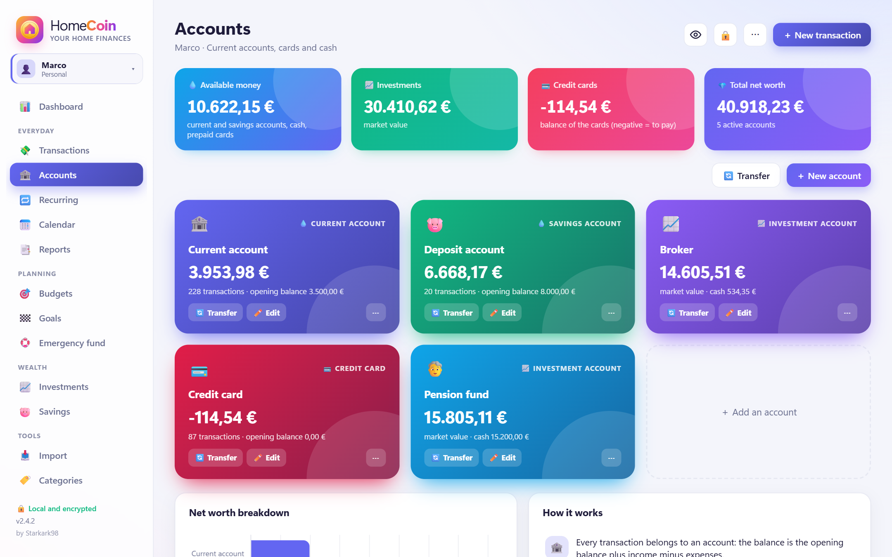
*Accounts: money available, investments, cards and net worth, then one card per account.*

**What you see**
- At the top: the **money available** (current and savings accounts, cash, prepaid cards), the **investments** at market value, the **credit cards** (if you have any) and the **total net worth**.
- One card per account, with its balance (or market value for investment accounts), the number of transactions and the opening balance; below, the **net worth breakdown** by account.

**What you can do**
- **＋ New account:** name, type, **opening balance** (what it holds on the day you start using HomeCoin), color and icon. HomeCoin suggests the type from the name (for example *Credit card* or *Broker*), and explains below the box how that type counts.
- **🔄 Transfer** moves money between two accounts.
- Click a card to see its transactions. Its **⋯** menu has *Check for money recorded twice* (an income and a transfer for the same money, the same import done twice: the most coherent record is kept) and *Compare with an automatic backup*.
- **Archive** an account you closed (✏️ Edit → *Archived account*): it disappears from the lists, but its history stays in the totals of the past.

#### Account types

The type decides how an account counts. Choose it carefully: changing it later between a cash type and *Investment account* recalculates net worth, emergency fund and savings of past months too (HomeCoin asks before doing it; transactions are never changed).

| Type | Its balance is | Net worth | Emergency fund | Notes |
|---|---|---|---|---|
| Current account, Savings account, Prepaid card, Cash, Other | available cash | yes, at book balance | yes | income and expenses count in reports, budgets and savings |
| Credit card | the card debt (usually negative) | yes, as cash, even when negative | as cash | expenses count when you buy; the monthly statement is a **transfer** from the current account to the card |
| Investment account | the **market value**: cash + securities, or the values you type | yes, at market value | only uninvested cash and money market funds | incoming transfers are **contributions** (capital put in), not expenses; see [Investments](#investments) |

**Tips**
- A credit card can have a negative opening balance (what you owe today).
- HomeCoin refuses to delete accounts that still have data, and warns you before a change that would alter your figures.

### Recurring payments

**What it is for.** Payments that repeat (rent, mortgage, loans, bills, subscriptions, salary, transfers to savings) are set up once. On each due date HomeCoin records the transaction for you.

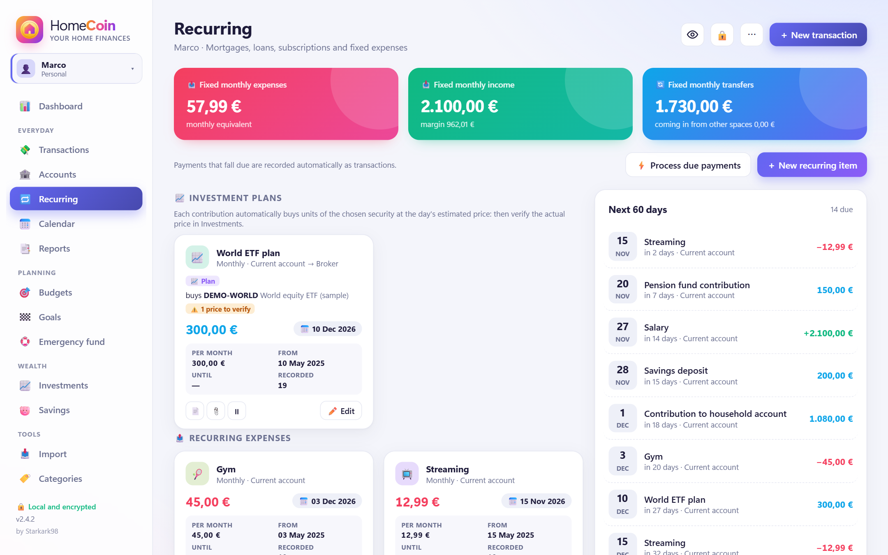
*Recurring: monthly totals at the top, one card per item, the next 60 days on the right.*

**What you see**
- At the top, the three kinds as a monthly amount: **fixed expenses**, **fixed income** (with the margin left each month) and **fixed transfers** (with those coming in from other spaces).
- One card per item, grouped (investment plans, expenses, income, transfers): the amount and the next date, then on one line the monthly equivalent, the start and end dates and how many payments were recorded. Loans show the installment number and the remaining debt.
- On the right, **Next 60 days**: every due date coming up.

**What you can do**
- **＋ New recurring item**, starting from a ready-made model (mortgage, rent, furniture loan, car loan, bill, subscription, insurance, salary, automatic savings) or from scratch. **Frequency:** weekly, monthly, every 2 months, quarterly, every 6 months, yearly.
- **⏸ Pause** and **▶ Resume**, **📄 Transactions** (the ones it recorded), **✏️ Edit**. When you delete an item you choose whether to keep the transactions it recorded or delete them too.
- **⚡ Process due payments** records at once anything already due (HomeCoin also does it by itself when you sign in).

**Special items**
- **Loans in installments:** add the number of installments, the amount borrowed and the rate, and the loan appears in [Mortgage and loans](#mortgage-and-loans). With *constant principal* repayment you don't type the amount: HomeCoin records each installment with its own amount, taken from the schedule.
- **Investment plans** (regular savings plans, also known as dollar-cost averaging; *PAC* in Italy): a monthly transfer to an investment account can buy units of a security automatically, at an estimated price; HomeCoin reminds you to confirm the real price after 30 days.
- **Variable items** (a bill or salary that changes a little every time): mark them as *expected*. HomeCoin does not record them by itself: it links the real transaction when it arrives (by a keyword in the description) and forecasts the next amount as the **median** (the middle value) of the last six payments. After a raise or a new tariff you can tell it to use the amount you set instead, until the median catches up. The card shows the expected date (it does not move while you wait) and a warning when a payment is more than a week late. When the money arrives, **＋ Record the one that arrived** opens a new transaction already filled in like the item: correct the real amount and date, save, and it is linked.
- **Recurring transfers between spaces** (for example your monthly share to the household account) are one item, set up in the space the money leaves: choose *Transfer* and answer *Where does the money go? → To another space*. The receiving space shows the item too, marked *from …, read only*: it can be changed only where it was created, so the same money is never planned twice.

**Tip.** Pausing an item or changing its dates never creates payments in the past by surprise.

<details>
<summary><b>Reconcile: the same money recorded in other ways</b></summary>

On a recurring transfer to another space, **🔗 Reconcile** (also proposed when you save one) looks for the same money already recorded in other ways (similar amount, close date) and proposes, line by line:

- linking the transfers already recorded;
- turning the expenses of those due dates into the transfer, including the past payments of a recurring expense you have just changed into a transfer (ticked, because they are its own payments);
- deleting an income in the receiving account that records the same money a second time;
- removing other recurring items for the same money (a recurring income in the receiving space, a recurring expense, a second recurring transfer). Their past transactions stay, and the amount of this recurring transfer is the one that counts.

An income with no matching transfer stays as it is. Tick it only if that money really left your account: then it becomes the transfer, and your account's balance goes down. Nothing changes until you confirm, you see the effect on both spaces first, and a backup is saved before the change.

</details>

### Calendar

**What it is for.** A **cash-flow forecast**: will there be enough money in your accounts for the payments of the coming months?

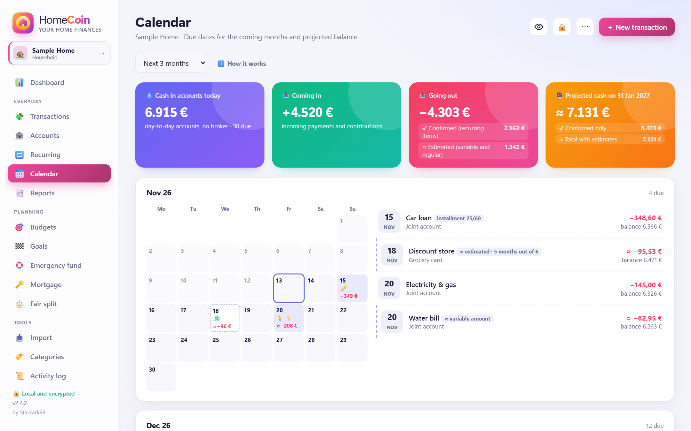
*Calendar: confirmed and estimated payments, with the cash left after each one.*

**What you see**
- **Cash in accounts today**, what is **coming in** and **going out**, and the **projected cash** at the end of the period, each split into *confirmed* (recurring items) and *estimated* (≈: variable items, and regular income or expenses guessed from your history).
- A monthly grid with the due dates, and next to it the list of payments with the **balance after each one**.

**What you can do.** Choose the period: this month, the next 3, 6 or 12 months. Point at a day to see its payments; each day shows the net amount, and ≈ marks the estimated ones.

**Tip.** *Cash* here means your day-to-day accounts (current and savings accounts, cards, cash), where payments actually go through; money on a broker is not counted. The [Emergency fund](#emergency-fund) counts more (see there). Estimates appear only for significant amounts that repeat in your history.

### Reports

**What it is for.** Where the money went, category by category and month by month.

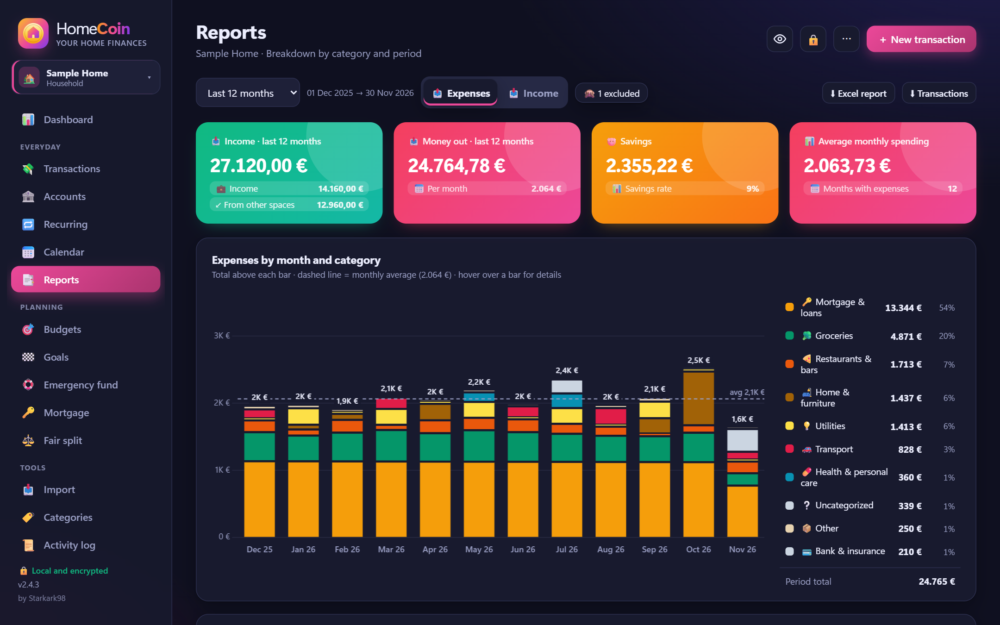
*Reports: categories month by month as a chart and a table (heatmap), with averages.*

**What you see.** The totals of the period (income, money out, savings, average monthly spending), a stacked chart of the categories by month with the monthly average as a dashed line, and a **heatmap** table (darker cells = higher amounts) with totals and shares.

**What you can do**
- Switch between **expenses**, **income** and **other spaces**, and choose the period (this year, last 12, 6 or 3 months, last month, this month, a past year, all).
- Click a category in the legend to hide or show it; click a cell to see its transactions.
- **⬇ Excel report** (a workbook with the summary by category and month) or **⬇ Transactions** of the period.

## Planning

### Budgets

**What it is for.** A **monthly limit** for the categories you want to watch, with a warning before you overspend.

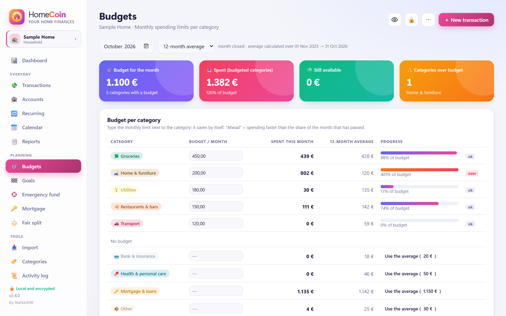
*Budgets of a closed month: one category went over its limit.*

**What you see.** The budget of the month, what you have spent in budgeted categories, what is still available, and how many categories are over budget; then, for each category, the limit, the spending of the month, the average of past months and a progress bar with its state: *ok*, **ahead** (spending faster than the month is passing: 60% of the budget spent after a third of the month, for example) or **over**.

**What you can do**
- Type the limit next to a category: it saves by itself. **Use the average** fills it in from the past months.
- Choose the month and how the average is calculated (last 3, 6 or 12 months, or all).

**Tip.** Budget only the few categories you can really control (eating out, shopping): fixed costs do not need one.

### Goals

**What it is for.** Something you are saving for: a trip, a car, a down payment.

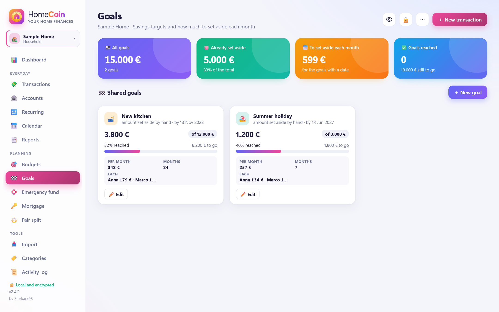
*Goals: progress, amount still to go and how much to put aside each month.*

**What you see.** At the top, the total of all goals, what is already set aside, what to set aside each month for the goals with a date, and how many are reached. Each goal shows its progress, the amount still to go and **how much to put aside each month** to get there on time.

**What you can do.** **＋ New goal** with an amount and, if you want, a date. Its progress comes either from **the balance of an account** (for example a savings account dedicated to it) or from **an amount you update by hand**.

**Tips**
- In a household space HomeCoin also shows each person's monthly share, in proportion to income.
- It warns you if the date has passed, or if two goals use the same account (the same money would be counted twice).

### Emergency fund

**What it is for.** How many months of expenses your reserve would cover if your income stopped.

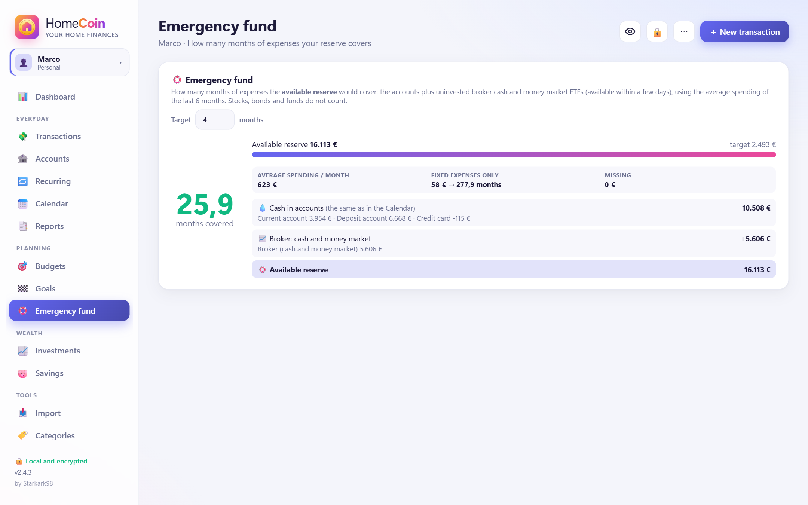
*Emergency fund: months covered, target, and where the reserve comes from.*

**What you see**
- The **months covered** by your **available reserve** (your liquid assets): your accounts plus uninvested cash and money market funds on your broker (money you can get within days). Stocks, bonds and other funds are not counted.
- The target, the amount missing, the average monthly spending and, for comparison, the months covered by fixed expenses only.
- Where the reserve comes from: each account and each broker.

**What you can do.** Set your target in months (often 3 to 6).

**Tip.** The average spending uses your last 6 complete months; HomeCoin tells you if you have less history than that.

### Mortgage and loans

**What it is for.** Every recurring item with installments, with its **amortization schedule**.

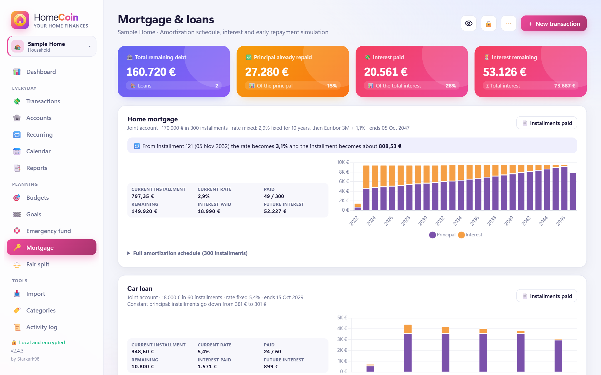
*A mixed-rate mortgage (constant installment) and a car loan with constant principal, with principal and interest per year.*

**What you see.** For each loan: the installment, split into **principal** (the part that repays the debt) and **interest**; the **remaining debt** (outstanding principal); interest paid and still to pay; the end date; and a chart of principal and interest per year. **📄 Installments paid** lists the transactions.

**What you can do**
- **Repayment method** (Recurring → the loan → *Repayment*):
  - **Constant installment** (French amortization, the most common): the same amount every month as long as the rate does not change. At the start most of it is interest; over time the principal part grows. When the rate changes, the installment is recalculated.
  - **Constant principal** (Italian amortization; *SAC* in Brazil): every installment repays the same share of the debt, plus the interest on what is left. Installments start higher and go down, and the total interest is lower.
- **Rate:** fixed, variable or mixed (for example fixed for 10 years, then variable). A variable rate is a reference **index** plus a fixed margin, the **spread**. HomeCoin offers the indexes of your currency; you type the current index value by hand (HomeCoin does not download rates).
- **Early repayment** (prepayment): try an extra payment and choose whether to **shorten the loan** (same installment; with constant principal, the same share of principal each month) or **lower the installment** (same end date). HomeCoin shows the interest you would save.

**Tips**
- A loan keeps its index even if you change currency. APR (the annual percentage rate including costs) and ancillary costs (insurance, fees) are not included.
- **Inflation-linked loans** (common in Brazil, with IPCA): choose a variable rate, type the yearly inflation as the index value and the loan's real rate as the spread. The schedule is then an estimate, because future inflation is unknown: update the index value from time to time.

<details>
<summary><b>Indexes offered for each currency</b></summary>

| Currency | Indexes |
|---|---|
| EUR | Euribor 1M, 3M, 6M, 12M |
| USD | SOFR 30-day average, Term SOFR 1M, 3M, 6M, 1-year Treasury (CMT), US Prime Rate |
| GBP | Bank of England Bank Rate, SONIA |
| CHF | SARON |
| CAD | Canadian prime rate, CORRA |
| AUD | RBA cash rate, BBSW 3M |
| MXN | TIIE 28, TIIE de Fondeo |
| COP | IBR, UVR (inflation-linked unit), DTF |
| CLP | UF (inflation-linked unit, used by most mortgages), TPM (monetary policy rate) |
| BRL | TR, IPCA, Selic, CDI |
| ZAR | Prime lending rate, SARB repo rate, ZARONIA (replaces JIBAR from 2026) |
| NZD | RBNZ official cash rate (OCR) |
| SGD | SORA 3M and 1M (compounded) |
| HKD | HIBOR 1M, Hong Kong prime rate |
| PHP | BSP policy rate |
| INR | RBI repo rate, MCLR 1Y |
| AED | EIBOR 3M, 1M |
| MYR | Standardised base rate (SBR), overnight policy rate (OPR) |
| SEK | STIBOR 3M, SWESTR, Riksbank policy rate |
| NOK | NIBOR 3M, NOWA, Norges Bank policy rate |
| DKK | CIBOR 3M, CITA |
| ILS | Bank of Israel prime rate, CPI-linked (inflation) |
| CZK | PRIBOR 3M, CNB 2-week repo rate |
| PLN | WIBOR 3M, WIBOR 6M, POLSTR 1M (compounded: the index that replaces WIBOR in new loans) |
| JPY | Short-term prime rate (the base of most variable home loans), TONA, TIBOR 3M |
| TWD | Chunghwa Post 2-year deposit rate (the base of index-linked mortgages), CBC discount rate |
| KRW | COFIX (new), CD 91-day rate, Bank of Korea base rate |

</details>

### Fair split

**What it is for.** In household spaces: instead of splitting shared costs 50/50, how much each person should pay into the joint account so that **everyone saves the same share of their income** (the same savings rate). Whoever earns more pays more, in proportion.

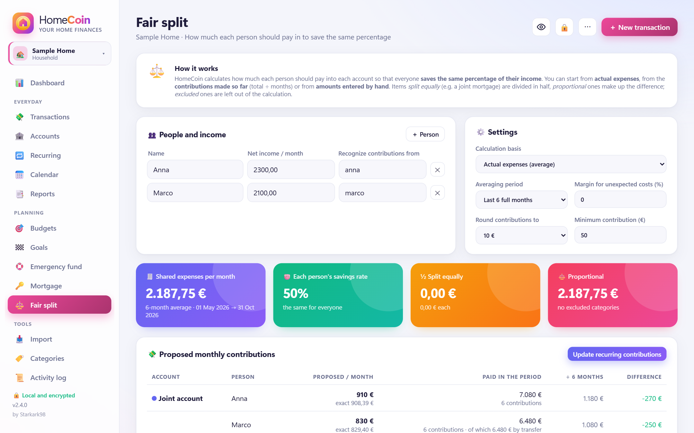
*Fair split: what each person should pay in, compared with what they actually paid.*

**What you can do**
1. Add the people (**＋ Person**) with their net monthly income and the word that recognizes their contributions in the descriptions (usually their name).
2. In **Settings**, choose the **calculation basis**: actual expenses (average), contributions made so far (total ÷ months), or amounts you enter by hand (**⤵ Prefill from actual expenses** fills them from the averages per category). Then the averaging period, a margin for unexpected costs (%), the rounding of the contributions and a minimum contribution.
3. For each category: split **in proportion**, **equally** (for example a joint mortgage, divided in half) or leave it **out** of the calculation.
4. HomeCoin proposes the monthly contribution of each person to each account and compares it with what each person really paid; **Share and savings** shows, for each person, the share and the savings rate, fair against actual.
5. **Update recurring contributions** changes the recurring transfers of each person in one click.

**Tip.** The actual amount paid counts the contributions recorded as income in the household and the transfers received from the people's personal spaces.

## Wealth

### Investments

**What it is for.** Your investment accounts (broker, pension fund…): how much they are worth, how much you put in and how they performed.

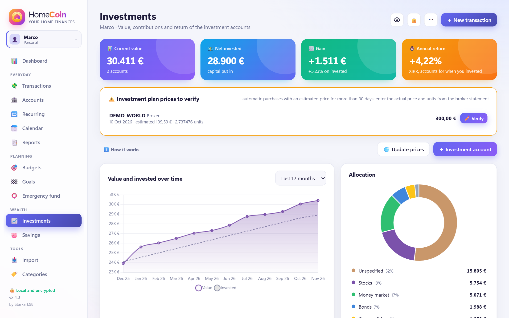
*Investments: value against contributions, gain, XIRR and allocation.*

**What you see**
- **Current value**, **net invested** (the money you put in, net of withdrawals), **gain** (value minus invested) with the **return** in %, and the **annual return (XIRR)**: it takes into account *when* you added or withdrew money (a money-weighted return), so accounts of different ages can be compared.
- The **value over time against the money you put in**, and the **asset allocation**: how your money is split among stocks, bonds, money market, commodities, cash and the rest.
- One section per account, with its securities: quantity, **average cost** (weighted average purchase price), price, value, **unrealized gain** (on what you still hold) and **realized gains** (from what you sold).

**What you can do.** There are two ways to follow an account, and you can mix them:
- **With securities and trades.** **＋ Security** with its **ticker**, the code it is quoted under on Yahoo Finance (for example `VWCE.DE` or `SWDA.MI`), and its asset class. **＋ Trade** records buys, sells, dividends, interest, fees, capital returns and splits.
- **With valuations.** For an account you only know the total of (for example a pension fund), **＋ Manual value** from time to time.

**🌐 Update prices** downloads the latest prices from Yahoo Finance, converted into your currency; it sends only the tickers, nothing else.

**Tips**
- Money that was already in the account when you added it to HomeCoin (its **opening balance**) counts as money you put in, not as gain.
- **Money market funds** are parked cash: buying or selling them does not count as invested, and they count toward the emergency fund.
- HomeCoin warns you about **investment plan prices to verify** (automatic purchases still at an estimated price after 30 days: **✏️ Verify** with the price from the broker statement) and about **cash idle** on the broker for 30 days or more (often a purchase you have not recorded).

### Rebalancing

**What it is for.** Over time some investments grow faster than others and your portfolio drifts away from the mix you chose. **Rebalancing** brings it back. Open it in Investments → 🧭 Rebalancing.

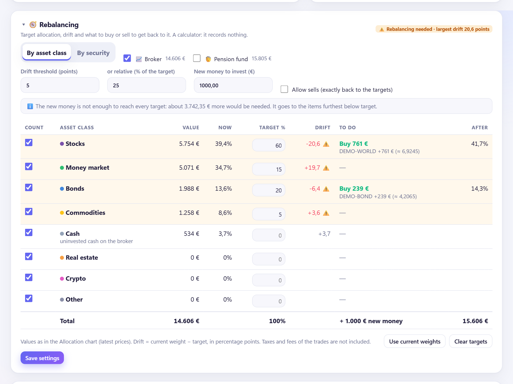
*Rebalancing with new money only: what to buy to move back towards the targets, with a note when the money is not enough.*

**What you can do**
- Set the **target allocation**: the weight in % of each asset class, or of each security. **Use current weights** starts from today's mix.
- Choose the method: **only new money** (the money you are about to invest goes to what is below target, without selling, so no taxes on sales) or **buys and sells** (exactly back to the targets).
- **When to act:** a drift threshold in percentage points (e.g. 5: a 60% target is off below 55% or above 65%) and/or relative to the target (e.g. 25%: a 20% target is off below 15% or above 25%). 0 switches a threshold off.
- Choose which accounts count, and leave out classes or securities you manage separately.
- **Save settings** keeps targets and choices for the next time.

**What you see.** For each row: value, current weight, target, **drift** (current weight minus target, ⚠️ when beyond the threshold) and **what to buy or sell**, with the weight after the operation.

**Tip.** It is a calculator: it never records trades. Taxes and fees are not included. HomeCoin warns you about anything that could make the result wrong: securities without a price, old prices, targets that don't add up to 100%, not enough new money.

### Savings

**What it is for.** Your habits month by month: how much you save and invest, and how your net worth grows.

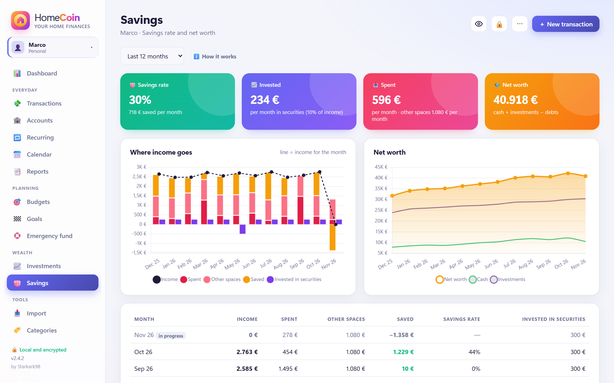
*Savings: savings rate, invested amount and net worth over time.*

**What you see**
- The **savings rate** (the share of income you saved), the amount **invested** per month, what you **spent** and your **net worth** (cash + investments − debts).
- **Where income goes**, month by month: spent, given to other spaces, saved, and invested in securities; the **net worth** over time with cash, investments and debts.
- A table with every month. The current month is marked *in progress*: until it is over, its income may not have arrived yet, so its result is not final.

**What you can do.** Choose the period (last 6, 12, 24 or 36 months, or all).

**Tip.** *Saved* is the surplus of the month (income minus spending minus money given to other spaces), not the change in your accounts. *Invested* is purchases minus sales of securities (money market funds excluded), even if paid with earlier savings.

## Tools

### Importing bank statements

**What it is for.** Bringing in the transactions of your bank without typing them: most banks let you download them as **CSV or Excel** from online banking.

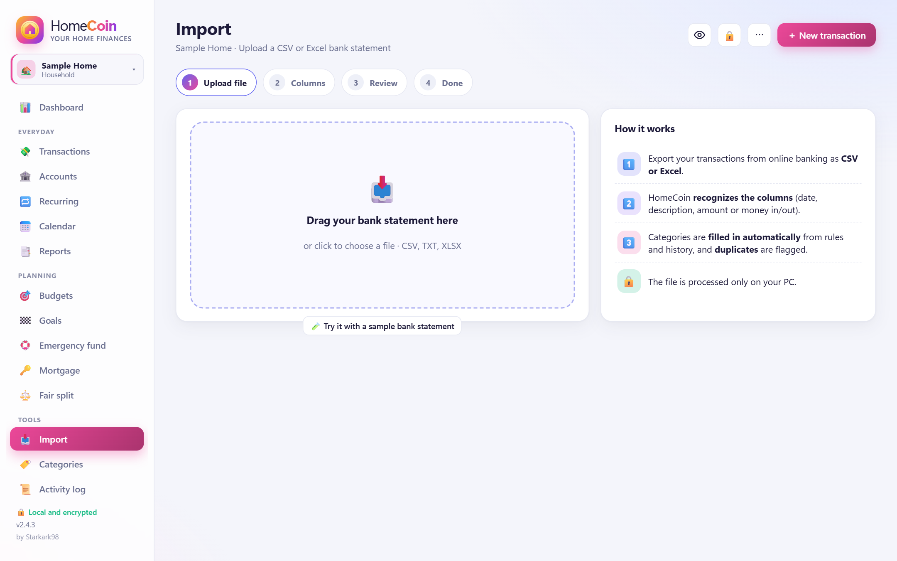
*Import: drag the statement, check the columns, review, done.*

**What you can do**, in four steps:
1. **Upload** the file (drag it onto the page or click to choose it). **🧪 Try it with a sample bank statement** shows how it works with made-up data.
2. **Columns:** HomeCoin recognizes date, description and amount (a single signed amount, or separate money in / money out columns, i.e. credits and debits). Check them and choose the account the statement belongs to.
3. **Review:** each row gets a category from your [rules](#categories-and-rules) or from history. Rows already in HomeCoin are marked *already present* and left out (tick them if you want them anyway). You can change any category before confirming.
4. **Done:** see what was imported, open the transactions still without a category, or import another file.

**Tip.** The file is read only on your PC and is never saved: HomeCoin keeps it in memory just until you finish.

<details>
<summary><b>Formats HomeCoin understands</b></summary>

- **Column names** in English, Spanish, Portuguese, German, French, Italian, Dutch, Polish, Japanese, Chinese and Korean (accents and capital letters don't matter). Files saved by Polish, Japanese, Taiwanese and Korean banks in the older Windows encodings are read correctly.
- **Money in or out in its own column.** Some banks (ING in the Netherlands, many German banks) write every amount as positive and say in another column whether it went out or came in (*Af/Bij*, *S/H*, *Soll/Haben*). HomeCoin recognizes that column and gives each amount its sign; you can also choose it by hand.
- **Date format.** Banks write dates as day/month/year (31/12/2026), in the US and the Philippines as month/day/year (12/31/2026) and in East Asia as year/month/day (2026/12/31, 2026年12月31日, 2026.12.31). HomeCoin reads the order from the dates in the file (a first number over 12 can only be a day). When every date fits both, for example 03/04/2026, it assumes the order of your currency's country and tells you to check it. You can always change it in the *Date format* box.
- **Already present** means the same amount on the same account within 3 days.

</details>

### Categories and rules

**What it is for.** **Categories** group your spending and income (Groceries, Utilities, Salary…); **rules** give new transactions their category by themselves.

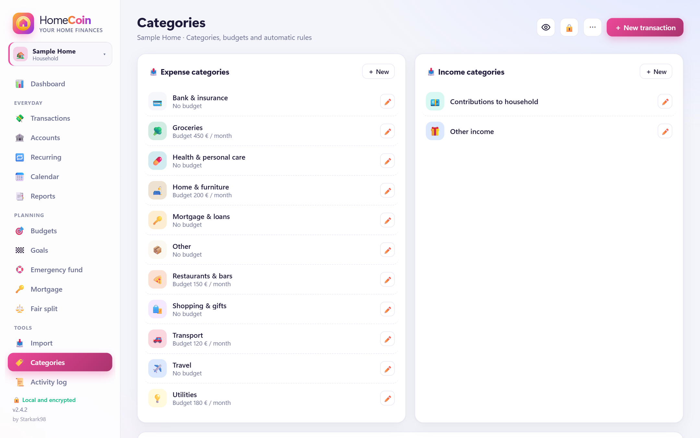
*Categories: expense and income categories, and the automatic rules.*

**What you can do**
- **＋ New** category, or ✏️ to edit one: name, color, icon and, for expenses, a monthly [budget](#budgets).
- **＋ Add rule:** *if the description contains "supermarket", the category is Groceries*. Rules apply to new and imported transactions; **⚡ Apply to uncategorized transactions** applies them to the ones already there. Besides the rules, HomeCoin learns from the transactions you have already categorized.
- **Turn into transfers…** (in an expense category's window): turns the expenses of the category into transfers to another space, for money you recorded as an expense but that went to another space (for example your monthly share to the household account). Details below.

**Tips**
- Keep categories few and broad: reports are easier to read. Create rules only for the payees you see often.
- **How a transfer between spaces is counted:** it is not spending. In the space it leaves, it counts under *Other spaces* (money given to another space); in the space it reaches, under *From other spaces* (money received, like an income for your savings).

<details>
<summary><b>Turn into transfers: how it works</b></summary>

Choose the space and tick the accounts the money reaches there; it can be more than one, for example a joint account and a bills account. Then:

- each expense becomes a transfer, with the same amount, date and description, and appears in both spaces;
- **the account is the one where the money really arrived**: HomeCoin looks for the matching record among all the ticked accounts. An expense with no matching record goes to the account you choose as default, or stays an expense if you prefer. Each row has its own account menu to correct it;
- **one payment received in two accounts**: if two incomes in two different accounts together make the amount of one expense, the expense is split into two transfers, one per account. Together they are exactly the expense, so nothing changes on your side;
- money already recorded is recognized, so nothing is counted twice. "The same money" means a similar amount and a close date; you choose how close (by default 2% and 5 days, up to 100% and 31 days). The percentage is of the smaller amount, the way people say it: 600 is 50% more than 400. A pairing whose amounts differ by more than 2% is never applied by itself: it is shown in red, unticked, and you tick it only if it is the same money:
  - the same money as an **income** in the destination account (for example from an imported bank statement) is replaced by the transfer;
  - an expense that is already there as a **transfer** to that account is a duplicate (a double record) and is deleted;
  - each record is paired only once, and HomeCoin looks for the best pairing of all of them together (not just the closest one each time), so similar amounts repeated in the same weeks are paired correctly;
  - when the amounts differ a little, the transfer keeps the amount of the expense (the money that left your account);
- recurring items are never changed by themselves. The category's recurring expenses are listed, unticked, and only the ones you tick become recurring transfers. Each one gets the account of the recurring income that looks like the same money in the other space; if two recurring incomes in two accounts together make it, it can become two recurring transfers. You can always change the account. A warning tells you if a recurring transfer to that account already exists for the same money, which would record it twice. It also tells you if the receiving space has a recurring income for it: right after the change, HomeCoin proposes to merge it ([Reconcile](#recurring-payments)). A recurring expense you leave as it is keeps recording expenses; mark the category as a contribution to other spaces to count them under *Other spaces* in the meantime.

The balance of the account the money leaves does not change, because the money already left it.

**The preview** shows, before anything changes:
- each expense and what happens to it (*becomes a transfer*, *replaces the income of…*, *duplicate, deleted*, with any difference in the amount). Untick a pairing if it is not the same money;
- the effect on spending, savings, balances and net worth in both spaces. An expense converted with no matching income adds its money to the destination account. If that account's balance then no longer matches your bank, the money had been recorded there in another way, for example with a balance adjustment;
- a warning if a similar income is in another account of that space, which may mean you chose the wrong destination.

An encrypted backup of the database is saved before the change; each option can be switched off.

</details>

### Activity log

**What it is for.** An **audit log**: the important things that happened in the last 12 months.

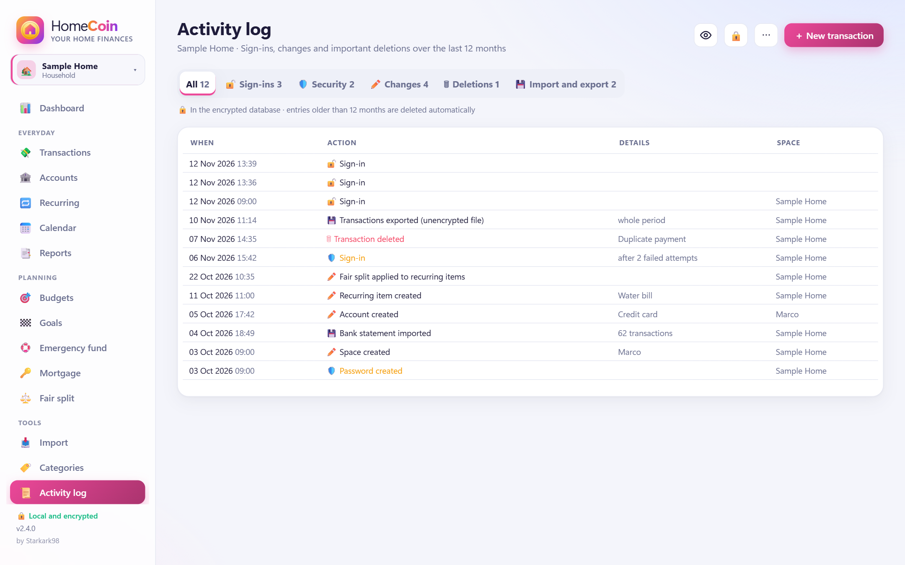
*Activity log: sign-ins, security, changes, deletions, imports and exports.*

**What you see.** When, what, the details and the space, for sign-ins (including wrong passwords), security changes, edits and deletions, imports and exports. Filter by kind with the buttons at the top.

**Tip.** It is stored in the encrypted database and cleans itself up after 12 months.

### Settings

**What it is for.** Your preferences, spaces, security, backups and updates, in five tabs.

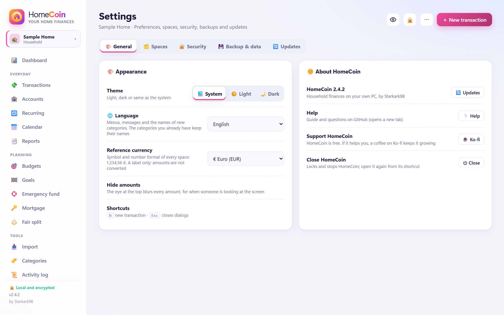
*Settings → General: theme, language, currency, help, support and close.*

| Tab | What you find |
|---|---|
| **🎨 General** | theme (light, dark or the same as Windows), [language and currency](#language-and-currency), *Hide amounts*, the shortcuts, and **About HomeCoin**: your version, Help, Support and Close HomeCoin |
| **🗂️ Spaces** | create, edit, archive [spaces](#spaces) and choose their pages; *Open* switches to a space |
| **🔐 Security** | the **security check**, password, recovery key, auto-lock, lock now, and the advanced *Import code* |
| **💾 Backup & data** | download or restore a backup, automatic backups, export, where your data is (see [Backups](#backups)) |
| **🔄 Updates** | check for a new version, install it, check automatically (see [Updates](#updates)) |

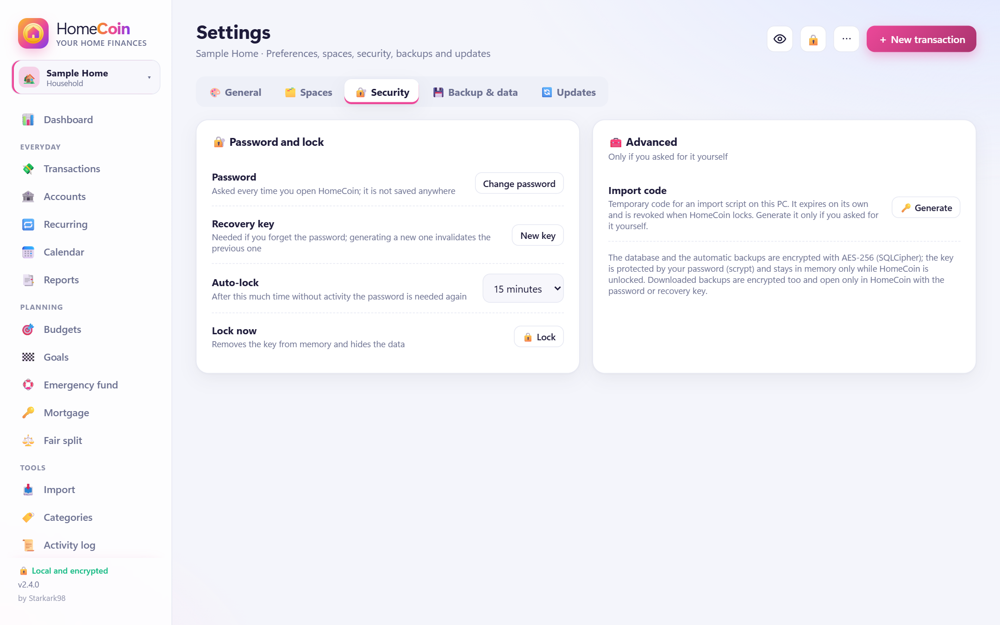
*Settings → Security: password and lock, and the advanced import code.*

**The security check** (🩺 *Check now*) looks at each protection and shows ✔ (fine), ⚠ (needs fixing, with the button to fix it) or ✖ (problem):
- **Database encrypted and intact**, with no unencrypted files in the data folder;
- **Data folder restricted to your user** (with **🔒 Protect** if other Windows users could open it);
- **Password** and **recovery key** protected with the current key strengthening (with **🔑 Generate new** for an old recovery key);
- **Auto-lock** (30 minutes or less is better);
- **Import code** not left active.

**Import code** (Security → Advanced): a temporary code for an import script of your own on this PC. Generate it only if you asked for it yourself: it expires on its own and is revoked when HomeCoin locks.

---

# Your data

## Password and recovery key

- The **password** is asked every time you open HomeCoin and after a period of inactivity (**auto-lock**, from 5 minutes to 2 hours, 15 by default, in Settings → Security). It is never saved anywhere.
- **Forgot it?** On the sign-in screen choose *Forgot your password? Use the recovery key* and enter your **recovery key**: you set a new password and get a new recovery key.
- You can change the password or create a new recovery key at any time in Settings → Security (the old key stops working).
- After a few wrong passwords HomeCoin makes you wait a little longer each time, even if it is restarted.

## Backups

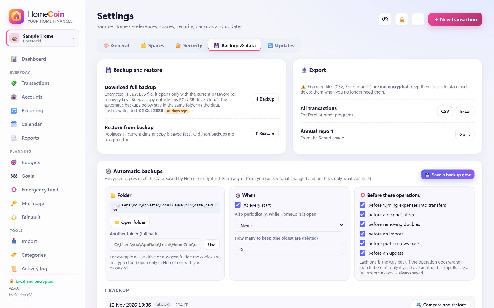
*Settings → Backup & data: download, restore, export and automatic backups.*

- **Downloaded backup:** Settings → Backup & data → **⬇ Backup** saves an encrypted `.hcbackup` file. Keep a copy **outside your PC** (USB drive, cloud storage): the automatic copies don't help if the disk breaks or the PC is stolen. The same page shows when you last downloaded one, with a warning after 30 days.
- **Automatic backups:** encrypted copies of all the data, saved by HomeCoin by itself. You decide everything in *Automatic backups*:
  - **where:** the folder is shown, with **📂 Open folder**; you can choose another one, for example a USB drive or a synced folder. If it cannot be reached (the drive is removed), backups go to the default folder next to the data until it is back;
  - **when:** at every start, and also every day or every week while HomeCoin is open;
  - **how many:** from 3 to 200 (the oldest are deleted; 15 by default);
  - **before which operations:** turning expenses into transfers, reconciling, removing doubles, importing, putting rows back, updating. Each one is the way back if the operation goes wrong, so switch it off only if you have another backup. Before a full restore a copy is always saved;
  - **by hand:** **💾 Save a backup now**.
- **Compare and restore:** next to each automatic backup, **🔍 Compare and restore** shows what changed since then in all the spaces, for transactions, recurring items, accounts, categories and rules: rows deleted (you can put them back), rows changed (you can take them back to how they were) and rows added. Only the rows you tick change; **Restore everything to this backup** replaces all the data instead. A copy of the current data is saved first. For a single account the same comparison is in its card: **⋯ → Compare with an automatic backup**.
- **Restore** (⬆ Restore) replaces all current data with a downloaded backup; HomeCoin saves a copy of the current data first. A backup opens only in HomeCoin, with the password (or recovery key) that was valid when it was made.
- **Export:** all transactions to CSV or Excel, and the annual report from Reports. Exports are **not encrypted**: HomeCoin reminds you before each one.

**Where the data is:** `%LOCALAPPDATA%\HomeCoin\data` (for example `C:\Users\you\AppData\Local\HomeCoin\data`), shown at the bottom of Settings → Backup & data. It is outside the program folder, so updating or uninstalling never touches it, and outside Documents, which is often synced to the cloud. It is not a temporary folder. If you used HomeCoin 1.1 or older, your data was moved there automatically the first time you started 1.2, checked file by file; the old folder is kept as `data.migrated-<date>` until you delete it.

## Moving to a new PC

1. On the old PC: Settings → Backup & data → **Backup**.
2. On the new PC: install HomeCoin and go through the first start (any password).
3. Settings → Backup & data → **Restore**, choose the file and enter the password **of the old installation**.

## Updates

When a new version is published, a small **⬆ HomeCoin x.y.z is available** label appears at the top and a dot on Settings. Open Settings → **Updates**, read what's new and click **Update**:

- **Installed version:** the new installer runs by itself in the background and HomeCoin reopens. The page reloads on its own.
- **ZIP version:** the program files are replaced in place (a copy of the old ones is kept) and HomeCoin restarts.

Your data is never part of an update, and an encrypted backup is saved first. How it stays safe:

- only **published versions** are offered, never test builds, and never an older version;
- every version is **digitally signed by the author** (Ed25519): HomeCoin checks the signature with the public key built into the program and refuses anything else, even if it comes from GitHub;
- every downloaded file is checked against its fingerprint (SHA-256 hash) before anything is installed;
- nothing happens until you click **Update**.

**Check automatically** (on by default) asks GitHub at most once a day, after you sign in, and sends nothing about you; **Check now** does it right away. You can always install a new version by hand too: run the new installer, or extract the new ZIP over the old folder.

## Privacy and security

**In short:** your data stays on your PC, encrypted, and opens only with your password. HomeCoin has no account, no tracking, no ads and no cloud.

- **It does not go online,** except for two optional things: *Update prices* (sends only the tickers of your securities to Yahoo Finance) and the update check (asks GitHub for the latest version). *Help* and *Support* open GitHub and Ko-fi in a new tab only when you click them.
- **Only your PC can reach it.** HomeCoin listens on `127.0.0.1` (the loopback address), which other computers cannot reach, and refuses requests coming from other websites.
- **Encrypted data** (encryption at rest). The database and every backup are encrypted with AES-256. The key that unlocks them is itself locked by your password and by your recovery key (through a deliberately slow key derivation, scrypt, that makes guessing passwords very expensive), and stays in memory only while HomeCoin is unlocked.
- **Locked by default.** When HomeCoin starts, nothing can be read until you enter the password; it locks again after inactivity.
- **Your Windows folder.** The security check verifies whether other Windows users on the same PC could open your data folder (its access control list) and can restrict it to you, SYSTEM and the administrators with one click. It uses the standard Windows tools `icacls` and `whoami`, so it also works where a company policy restricts PowerShell.

<details>
<summary><b>Technical details</b> (for those who want to check)</summary>

- **Database:** SQLite with SQLCipher 4 (AES-256), temporary data in memory only, deleted rows overwritten (`secure_delete`).
- **Keys:** a random data key, stored in `keystore.json` only in encrypted form (AES-256-GCM), once with a key derived from the password and once from the recovery key, both with scrypt N=2^17 (about 128 MB per attempt). The password is verified by trying to decrypt the data key; it is never stored. Always copy `keystore.json` together with the database.
- **Backups:** `.hcbackup` files are encrypted with the data key (AES-256-GCM) and carry that key only in its password-protected form, so a backup is as safe as your password is strong.
- **Web protections:** Host header check (DNS rebinding), writes require a custom header and a local Origin (CSRF), requests marked `Sec-Fetch-Site: cross-site` refused, HttpOnly + SameSite=Strict session cookie, one active session, strict Content-Security-Policy, no iframes, a Permissions-Policy that denies camera, microphone, location, payments and devices, no server name or version disclosed.
- **Temporary import code:** for your own local import scripts (Settings → Security → Advanced); it can never use security functions, backups, restores, exports or updates, and it is revoked when HomeCoin locks.
- **Libraries:** installed only from ready-made packages at exact versions, each checked against its SHA-256 (`requirements.lock`), and checked for known vulnerabilities before every release. Chart.js is bundled; no CDN.
- **Updates:** a manifest listing each file's size and SHA-256, signed with Ed25519; the private key never leaves the author's PC.
- **Custom data folder:** set the environment variable `HOMECOIN_DATA_DIR`.

</details>

---

# More

## Glossary

| Term | Meaning |
|---|---|
| **Space** | a separate set of books inside HomeCoin (household, personal), with its own accounts and categories ([Spaces](#spaces)) |
| **Opening balance** | what an account held on the day you started using HomeCoin ([Accounts](#accounts)) |
| **Transfer** | money moved between two of your accounts, even of different spaces: never an expense or an income |
| **Excluded transaction** | counts in the account balance, not in reports, budgets and savings ([Transactions](#transactions)) |
| **Net worth** | everything you own minus what you owe: cash, investments at market value, minus debts such as card balances |
| **Savings rate** | the share of income you saved in a month: saved ÷ income ([Savings](#savings)) |
| **Money out** | spending plus money given to other spaces |
| **Recurring item** | a payment that repeats, recorded by HomeCoin on its due dates ([Recurring payments](#recurring-payments)) |
| **Variable (expected) item** | a recurring payment whose amount or date changes; forecast with the median of the last six |
| **Median** | the middle value of a list: half of the values are above it, half below; less affected by one unusual payment than the average |
| **Cash-flow forecast** | the money you will have in your accounts after the coming payments ([Calendar](#calendar)) |
| **Budget** | a monthly limit for a category ([Budgets](#budgets)) |
| **Available reserve** | accounts plus uninvested broker cash and money market funds: the money you can use within days ([Emergency fund](#emergency-fund)) |
| **Amortization schedule** | the list of a loan's installments, each split into principal and interest ([Mortgage and loans](#mortgage-and-loans)) |
| **Principal / interest** | the part of an installment that repays the debt / the cost of the loan |
| **Spread** | the fixed margin added to the index in a variable-rate loan |
| **Contributions (net invested)** | the money you put into an investment account, minus what you took out |
| **Average cost** | the weighted average price you paid for the units you hold |
| **Realized / unrealized gain** | the gain on what you sold / on what you still hold, at today's price |
| **XIRR** | the annual return that takes into account when each sum went in or out (money-weighted return) |
| **Asset allocation** | how your investments are split among stocks, bonds, money market, commodities, cash |
| **Drift** | how far a weight is from its target, in percentage points ([Rebalancing](#rebalancing)) |
| **Money market fund** | a very low-risk fund used as parked cash; HomeCoin counts it as cash |
| **Recovery key** | the second key to your data, for when you forget the password |
| **Encrypted backup (`.hcbackup`)** | a copy of all your data that opens only in HomeCoin with your password or recovery key |

## Questions and problems

**Windows says "Windows protected your PC".** The installer is not code-signed yet. Check the SHA-256 shown in the release (see [Install](#install)), then click *More info → Run anyway*. On some work PCs, company security rules block unsigned programs completely: use the ZIP version or ask your IT department.

**I forgot my password.** Use *Forgot your password? Use the recovery key* on the sign-in screen. Without both the password and the recovery key the data cannot be opened by anyone: this is what keeps it safe.

**The page says HomeCoin is closed, or doesn't open.** Start it again from its shortcut (or `HomeCoin.cmd`). If another program uses port 8765, start the ZIP version with `HomeCoin.cmd --port 9000`.

**An account balance does not match my bank.** Check the opening balance of the account (✏️ Edit), then look for missing or duplicated transactions: the account's **⋯ → Check for money recorded twice** helps, and so does filtering Transactions by that account and period.

**My amounts look wrong after changing the currency.** HomeCoin never converts amounts: the currency is a label. Switch back in Settings → General if your accounts are in the other currency.

**An imported row is marked "already present" but it isn't.** Tick it in the review step to import it anyway: HomeCoin flags rows with the same amount on the same account within 3 days.

**My investment return looks too high or too low.** Check that every transfer into the account is recorded, that prices are up to date (🌐 Update prices) and that investment plan purchases have their real price (✏️ Verify).

**The security check says the data folder is also accessible to other accounts.** It happens when the data is in a folder that other users of the PC can open (for example a folder you chose yourself under `C:\`). The data is encrypted anyway, but they could copy or delete it: click **🔒 Protect** next to the warning to restrict the folder to your Windows user. If anything goes wrong, the previous permissions are put back.

**Which version do I have?** It is written at the bottom of the left menu and in Settings → General → About HomeCoin.

**A page I need is missing from the menu.** Each space shows only its own pages: turn it on in Settings → Spaces (✏️ next to the space). Hiding a page never deletes its data.

**Where is my data, and how do I keep it safe?** See [Backups](#backups).

## Limitations

- Windows only. The Python code itself is portable, but the launchers and the folder protection are written for Windows and it is untested elsewhere.
- One user per installation: HomeCoin is a personal tool, not a server. Never expose it on a network.
- Bank statement formats vary: columns are recognized automatically, but some files may need a quick check in the preview.
- Prices come from Yahoo Finance and may be delayed, incomplete or missing for some funds.
- One currency per installation, chosen among twenty-seven (EUR, USD, GBP, CHF, CAD, AUD, NZD, ZAR, SGD, HKD, PHP, INR, AED, MYR, SEK, NOK, DKK, ILS, CZK, MXN, COP, CLP, BRL, PLN, JPY, TWD, KRW): accounts in different currencies cannot be mixed. Securities quoted in other currencies are converted using the exchange rates on Yahoo Finance. Mortgage indexes are typed by hand. In Excel exports, rupee amounts use Excel's usual grouping (1,234,567) instead of lakh and crore.
- No tax calculation: rebalancing and investments show figures before taxes and fees.
- The interface is in eleven languages (English, Spanish, Portuguese, German, French, Italian, Dutch, Polish, Japanese, Traditional Chinese, Korean); this guide is in English.

## Getting help

- **This guide** is what *Help* in the app opens.
- **Something doesn't work?** Open an [issue](https://github.com/Starkark98/HomeCoin/issues) with the *Bug report* template. Reproduce it in the demo if you can, and **never attach real data** (no database, backups, statements, amounts or names).
- **An idea or a suggestion?** Open an issue with the *Feature request* template: suggestions are very welcome.
- **A wrong or clumsy translation?** Open an issue with the *Translation* template: say the language, where the text appears and how you would write it. Native speakers' help is especially welcome.
- **A security problem?** Don't open a public issue: follow [SECURITY.md](SECURITY.md).

## Support the project

HomeCoin is free and will stay free. If it helps you, you can give the project a ⭐ on GitHub or buy me a coffee on Ko-fi:

[](https://ko-fi.com/starkark98)

## Contributing

See [CONTRIBUTING.md](CONTRIBUTING.md). Version history is in [CHANGELOG.md](CHANGELOG.md).

<details>
<summary><b>Project structure</b></summary>

```
homecoin/   app.py (API) · db.py (encrypted database, backups) · security.py (password, keys, data folder)
            services.py (balances, recurring items, categorization) · forecast.py (estimates) · split.py (fair split)
            tools.py (mortgage, investments, rebalancing, prices) · importer.py (CSV/Excel) · audit.py (activity log)
            i18n.py (languages) · updater.py (signed updates) · demo.py (sample data) · util.py (amounts, dates, currencies)
static/     index.html · css/app.css · js/app.js · js/theme.js · img/logo.svg · vendor/chart.umd.min.js
            i18n/<language>.json (one file per language)
icon/       app icons
docs/       images used by this guide
run.py      starts HomeCoin                  demo.py    starts the demo
setup.ps1   prepares the ZIP version         HomeCoin.cmd / HomeCoin-Demo.cmd    double-click launchers
```

</details>

## Built with AI assistance

To be clear and honest about how HomeCoin is made:

- **The project is mine, entirely.** Every idea, feature, concept and design choice in HomeCoin — what it does, how it works, how it looks — was conceived by me, **Starkark98**.
- **The code is written with the support of [Claude Code](https://www.anthropic.com/claude-code)**, Anthropic's AI coding assistant, which I direct and whose work I review and test.

HomeCoin is free and independent. Its purpose is simple: to help the people who use it take care of their money and build good habits with it.

As with any software, read the source and judge the results with care before relying on them (see the [Disclaimer](#disclaimer)).

## Disclaimer

HomeCoin is provided **"as is", without warranty of any kind**, as stated in the [LICENSE](LICENSE).

- Calculations, estimates, forecasts and schedules are **indicative**. They may be incomplete or inaccurate and **do not replace** bank statements, contracts, tax documents or the advice of a qualified professional.
- HomeCoin **does not give financial, investment, tax or legal advice**. Decisions based on its figures are your own.
- Security prices come from a third-party service and may be delayed, incomplete or wrong.
- Keep your password and recovery key safe and make regular backups: without them the encrypted data cannot be recovered by anyone, including the author.
- In no event shall the author or contributors be liable for any claim, damages or other liability, including data loss, financial loss or decisions taken on the basis of HomeCoin, arising from the use of or inability to use this software.
- HomeCoin is an **independent project**, not affiliated with, endorsed by or supported by any bank, broker or data provider mentioned here.

**Trademarks.** Microsoft, Windows, Microsoft Edge and Excel are trademarks of the Microsoft group of companies. Google Chrome is a trademark of Google LLC. Firefox is a trademark of the Mozilla Foundation. Yahoo and Yahoo Finance are trademarks of Yahoo Inc. Python is a trademark of the Python Software Foundation. Claude and Claude Code are trademarks of Anthropic, PBC. All other trademarks belong to their owners and are used here only to identify them.

## License

Copyright (c) 2026 Starkark98. Released under the **MIT License with the [Commons Clause](https://commonsclause.com/)**: see [LICENSE](LICENSE) for the full text. The bundled Chart.js library keeps its own MIT license.

In plain words (the LICENSE file is what legally applies):

| You can | You cannot |
|---|---|
| Use it for free, at home or at work | **Sell** it, alone or bundled with other software |
| Use it for your household, your family or your own business | Offer paid hosting, support or **services whose value derives entirely or substantially from it** |
| Modify it and share it, including modified versions, **free of charge** | Remove the copyright notice or the license text |

Any copy or modified version must keep the [LICENSE](LICENSE) file, including the Commons Clause. Because of the Commons Clause, HomeCoin is **source-available** software, not "open source" in the OSI sense.

**Commercial use not covered above?** Contact **Starkark98** through GitHub to ask for a separate license.

---

*HomeCoin by **Starkark98** · v2.4.1 · see the [changelog](CHANGELOG.md)*
